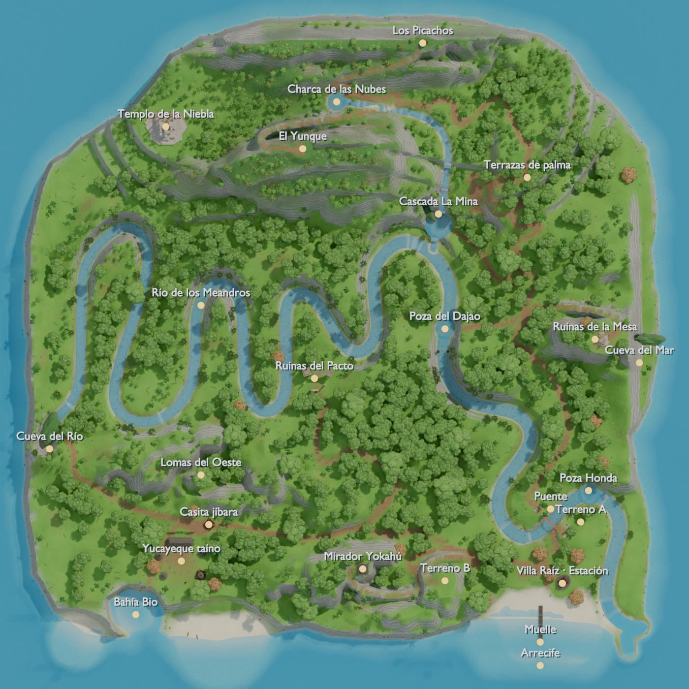

# Mapa Cap. 1 · El Yunque

Vistas: `img/mapa_aerea.png`, `img/mapa_vista_*.png`, `img/mapa_kelvin_*.png` y `img/mapa_estructuras_propias.png`.

## Base
El relieve sale del terreno original de Kelvin (`AV3DMaxTerrainExport.max`, a 0,255 m/u), con su río y sus mesetas. Encima van la isla de 470 × 465 m, las terrazas y la quebrada. Ejes: x al este, z al sur, mar en y = 0. Del muelle a la cumbre se tarda unos 3 min a pie (≈1,1 km de sendero) y unos 40 s volando.

## Zonas
- **Costa:** playa, laguna, arrecife, muelle y Bahía Bio.
- **Villa Raíz:** Estación, taller, plaza y puente colgante sobre un cañón.
- **Tabonuco:** Río de los Meandros, pozas y aldeas de Kelvin.
- **Lomas del Oeste:** casita y Cueva del Río, donde nace el río.
- **Palma de sierra:** tres terrazas con pasos en rampa y la cascada La Mina (9 m), con gruta y poza.
- **Enano y nublado:** Charca de las Nubes, el yunque (98 m) con las ruinas de Kelvin y Los Picachos.
- **Mesa del Este:** ruinas y Cueva del Mar.

## Flujo
Taller → plaza → puente, el primer hito. El sendero norte cruza el tabonuco hasta La Mina, sube las terrazas y llega a la cumbre por una escalinata. Los acantilados guían, pero se pueden volar (`corrientes`). Los secretos son las grutas, la Bahía Bio y las ruinas de Kelvin.

## POIs (x, y, z)
| id | pos | id | pos |
|---|---|---|---|
| spawn | 134, 5, 182 | terrenoA · poza_honda | 181, 4, 136 · 188, 3, 115 |
| plaza · estacion | 150, 5, 170 · 167, 3, 183 | terrenoB · mirador | 77, 26, 181 · 14, 35, 172 |
| puente · muelle | 158, 13, 137 · 150, 0, 205 | poza_dajao | 77, 5, −13 |
| poza_la_mina · gruta | 72, 10, −92 · 66, 10, −98 | | |
| charca · cumbre | −6, 66, −186 · −32, 98, −150 | picachos · templo | 60, 90, −231 · −137, 55, −167 |
| casita | −104, 18, 138 | cueva_rio | −226, 19, 80 |
| ruinas · cueva_mar | 198, 43, −4 · 232, 2, −3 | | |

Las misiones están en `misiones` (perchas y ruta de la gota, sin anillos). Las paradas de aprendizaje están en `pois`: parada_agua, parada_techo y parada_claro.

## Integración
- **Alturas:** `mapa_cap1_altura.js` es una rejilla Uint16 de 265 × 265, paso 2 m, con `alturaEn(x, z)`. El error es de 0,1 m de media y 0,15 m p95 en suelo caminable. En los acantilados, usar la malla.
- **Terreno:** `terreno_{no,ne,so,se}.glb` suman 37 400 triángulos. `COLOR_0` (unorm8) es el splat: R pasto/musgo, G tierra, B roca, A arena, y suma 1.
- **Agua:** `agua.glb` lleva espuma en `COLOR_0.r` y el flujo en la UV `v`. En los datos están `agua.rio/quebrada` (`[x, z, nivel, medioAncho]`), `pozas`, `cascadas`, `crecida` y `nivelAguaEn(x, z)`.
- **Colisiones:** `caja`, `cilindro`, `piso`, `rampa` y `puente`.
- **Edificios:** `edificiosKelvin` tiene los 9 puntos del layout. `escenaKelvin` es la escena original de Kelvin: 376 instancias en 14 zonas, ×0,837 como su terreno, con su giro intacto. Solo se ajusta la altura y se apartan 46 del agua y los senderos. `compacto` es el formato para streaming; `modelo:null` es un marcador hasta que llegue el modelo y `espera` es una pieza cuyo apoyo falta. Mis modelos son el respaldo.
- **Flora:** `densidad` es una rejilla de 8 m (valor/10 = instancias por 100 m²). Además: `libre` (máscara de 2 m), `heroes`, `densidadPorZona`, `modelos` y `variantes`.

Scripts: `tools/blender/mapa_{lib,build,kelvin,render}.py`.
