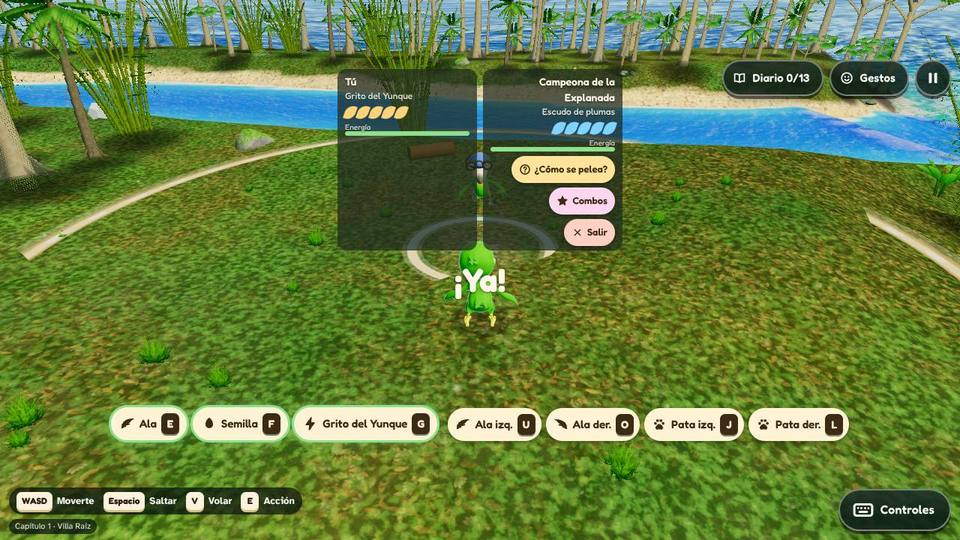
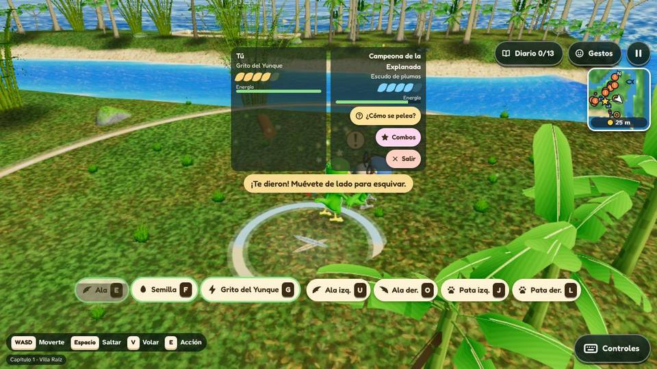
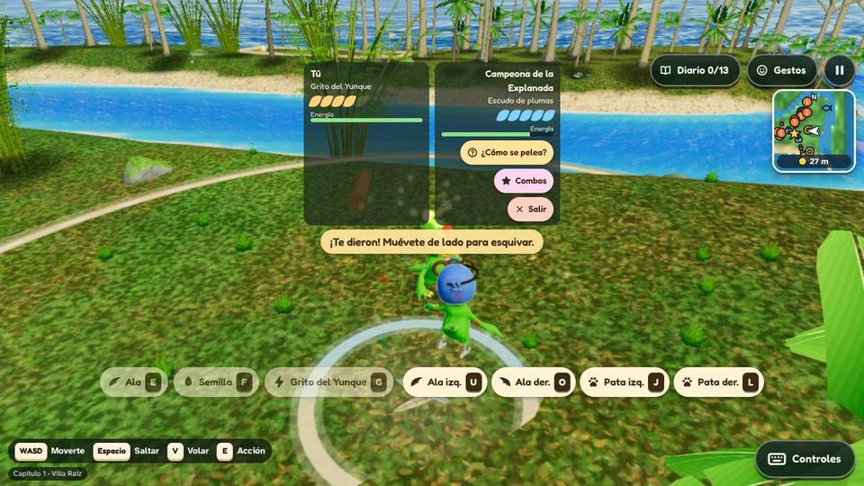
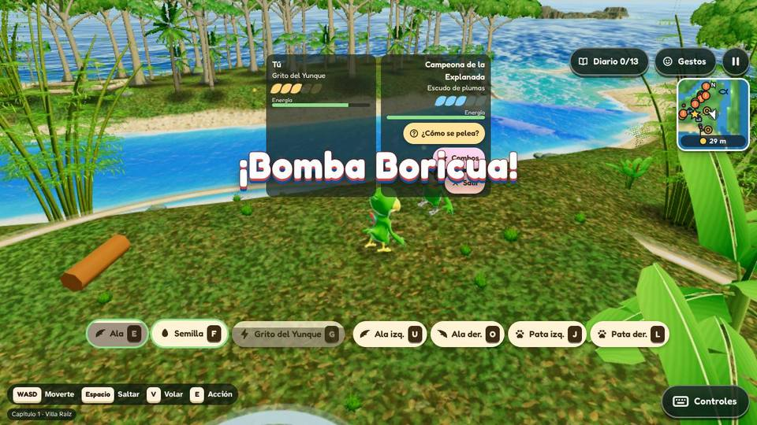
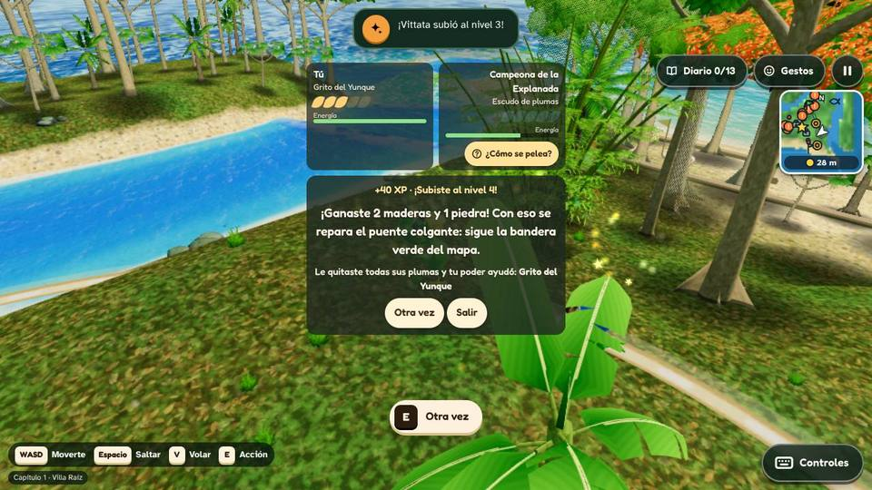
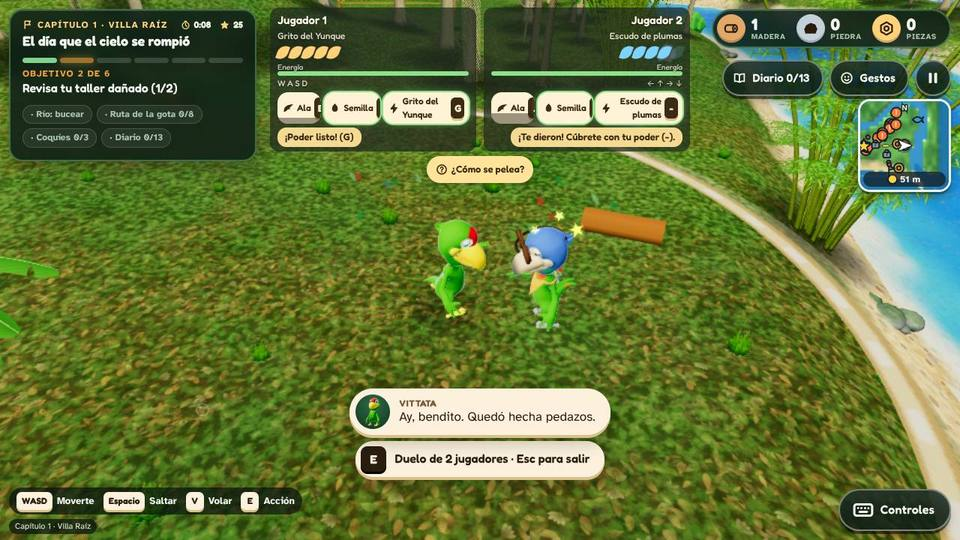
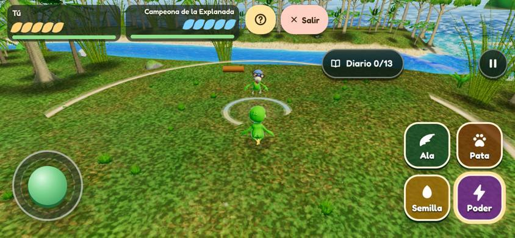
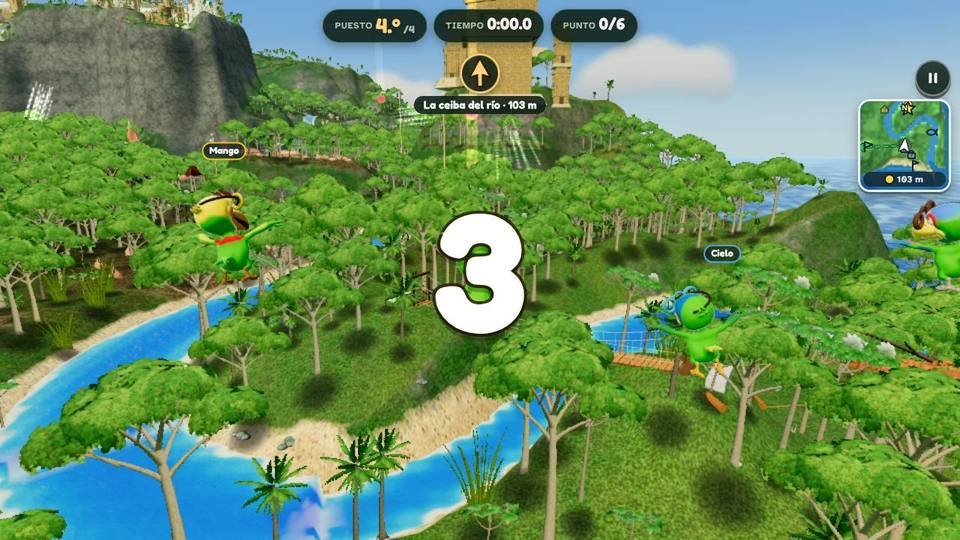

# F1 · Rediseño del VS (duelo, Duelo de 2 y carreras)

Claude web B (Fable) · 16-nov-2026 · **solo diseño; no hay código tocado.** Se implementa en N1.

**En una frase:** el duelo ya tiene las piezas (telegrafía, combos, poderes, hit-stop), pero hoy **no se ve, dura 9 segundos y no pide leer a la rival**. El plan no añade sistemas: hace visibles y con ritmo los que hay.

## 1. Lo que jugué

| Modo | Cómo | Dato medido |
|---|---|---|
| Duelo (Campeona, perfil Clásica) | 1280×720, teclado, con un robot que se acerca y pulsa E/U/O/F/G | Ganó 5–3 en **8,9 s de juego**; 4 combos; 1 golpe recibido por leer mal |
| Duelo (primera partida) | Igual, manteniendo «adelante» | A los **4,6 s** salió del círculo y el duelo se canceló («Te alejaste») |
| Duelo táctil | Capturas de T57 (390×844 y 844×390) | HUD limpio: franja arriba, 4 botones (`img/f1_07_tactil_bien.jpg`) |
| Duelo de 2 | 1280×720, J1 con WASD/E/U y J2 con «.» | 3 plumas quitadas en 5,9 s. **Aquí sí se ve la pelea:** cámara de las dos y paneles compactos arriba (`img/f1_08_duelo2_se_ve.jpg`) |
| Carrera en El Yunque | Salida y primeros tramos | HUD limpio, 3 rivales con nombre, puesto visible |
| Carrera con Chispa | Solo código (`chispa.js`); no logré arrancarla desde el robot | 4 banderines, Chispa a 5,4 m/s fijos y un gag |

El navegador de pruebas va con GPU por software: el tacto fino (60 fps) lo deduzco de los tiempos del código, no de la mano. El bug de la rival en pose T no cuenta aquí.

## 2. Diagnóstico

| Eje | Qué pasa hoy | Prueba |
|---|---|---|
| **Lectura** | En escritorio los dos paneles (380×240 px) están en el centro y **tapan a la rival y su «!»**. En el teléfono no pasa. | `img/f1_01_hud_tapa.jpg`, `img/f1_02_aviso_tapado.jpg` · `combate.js` `estilo()` |
| **Cámara** | Sigue a Vittata y solo gira 11° (`ORBITA`). La rival acaba fuera de plano, detrás de la cámara o de una mata. Al terminar se ve una planta, no a la ganadora. | `img/f1_03_rival_fuera.jpg`, `img/f1_05_final.jpg` |
| **Golpe** | El aviso dura 0,38–0,5 s y es un «!» pequeño. No hay botón de esquivar: «muévete de lado». El «¡Esquivado!» sale solo si casualmente estabas lejos. | `DIFICULTAD.aviso`, `usar()` l. 462 |
| **Ritmo** | Un duelo son 5 golpes: 9–20 s. No hay asaltos ni respiro. Un combo quita lo mismo que un golpe, así que machacar un botón rinde igual que jugar bien. | Partida medida; `img/f1_04_combo.jpg`; comentario de `COMBOS` |
| **Feedback** | Hay hit-stop (85 ms) y sacudida, pero el golpe que entra suena `land` (genérico), salen 8 plumas pequeñas y el último golpe es igual que el primero. | `golpear()` l. 305–306 |
| **Reglas** | Salir andando del círculo cancela el duelo. La Aprendiz reacciona (esquiva o escudo) al **96 %** de las semillas que ve venir: la dificultad sale de que tus tiros «no entran», no de que ella ataque mejor. | `SALIDA_R`, `DIFICULTAD[0].esquiva` |
| **Rivales** | Una sola rival con 4 niveles que solo cambian números. No se nota quién es quién. | `DIFICULTAD` |
| **Progresión** | Un premio (los Lentes) en la primera victoria y XP. No hay escalera ni motivo para la quinta partida. | `premioRopa()`, `pagar()` |
| **Carrera** | Es lo más redondo del VS. Falta interacción entre corredoras y una forma de remontar que dependa de ti (hoy la goma lo hace sola). Vittata queda tapada por el «3» de la salida. | `img/f1_06_carrera.jpg`, `retos.js` l. 1246–1259 |

## 3. Referencias de mecánicas (solo mecánicas)

| Género de referencia | Mecánica que funciona con 8–14 años | Cómo la traducimos aquí |
|---|---|---|
| Peleas de fiesta en plataformas | Pocos botones; lo difícil es el momento y el sitio, no la combinación | Seguimos con Ala, Pata, Semilla, Poder; se añade solo **Brinco** (esquivar) |
| Peleas de arena 3D con fijado | La cámara encuadra siempre a las dos; el control es relativo a esa cámara | Cámara del Duelo de 2 también contra la Campeona |
| Boxeo de dibujos con golpes largos | Ataques lentos y muy anunciados; ganar es **leer, esquivar y castigar** | Aviso más largo, con marca en el suelo, y hueco de castigo tras esquivar |
| Peleas por asaltos | Mejor de 3: perder un asalto no es perder; hay tiempo de aprender a la rival | Asaltos de 5 plumas, mejor de 3 |
| Escaleras de rivales de arcade | Cada rival enseña **una** cosa y se reconoce de lejos | 3 rivales: rápida, fuerte y lista |
| Carreras familiares | Rebufo, atajos con riesgo y ayudas al que va último (sin humillar al primero) | Rebufo, nubes y hojas en la ruta; sin proyectiles |

Nada de personajes, nombres, arte ni movimientos concretos de ningún juego.

## 4. Plan: 8 cambios por orden de impacto

### 1 · Que se vea la pelea (HUD de escritorio y cámara de dos)
- **Qué:** en escritorio, el HUD pasa a la franja del teléfono (plumas arriba a izquierda y derecha, «¿Cómo se pelea?», «Combos» y «Salir» en la esquina). La cámara encuadra a las dos, como en el Duelo de 2 (`encuadre()` / `camaraPaso()`), sin girar: solo se desplaza y se aleja. Al terminar, se queda con la ganadora celebrando.
- **Por qué:** hoy la rival y su aviso quedan tapados o fuera de plano; sin ver no hay lectura posible. El Duelo de 2 ya lo resuelve bien: se copia de ahí. De paso, durante el Duelo de 2 se oculta el HUD de la historia (objetivo, materiales, Diario), que hoy sigue en pantalla si se entra desde el mundo.
- **Archivos:** `src/game/v18/combate.js` (`estilo`, `montarHud`, `orbitar`, `alejarCamara`, `terminar`), `src/game/v18/duelo2.js` (sacar `encuadre`/`camaraPaso` a una función común).
- **Prueba:** en `AV.v18CombateTest`, un duelo de 30 s con el robot a 1280×720, 844×390 y 390×844: las dos cotorras y el «!» proyectados en pantalla no pisan ningún rectángulo del HUD y están en plano ≥ 95 % de los cuadros. Capturas antes/después.
- **Riesgo:** medio. Kelvin pidió que WASD coincida con lo que se ve: por eso la cámara no gira. Revisar el pasillo de cámara despejado (QA-174).

### 2 · Leer, esquivar y castigar
- **Qué:** (a) aviso por capas: la pose que ya existe + un arco en el suelo que se llena y enseña el alcance + sonido `aviso`; ala = arco ancho, semilla = línea. (b) Duración: 0,7 s en la primera rival, hasta 0,45 s en la Campeona. (c) **Brinco**: Saltar (Espacio; en táctil, un quinto botón pequeño junto al joystick) da un salto corto con 0,25 s sin daño, con la pose de esquiva de T41. (d) Esquive a tiempo: «¡Esquivado!», la rival queda abierta 0,8 s y cargas 15 de energía.
- **Por qué:** es el bucle que hace divertido un duelo a esta edad: ver venir, apartarse, devolver. Hoy esquivar es casualidad.
- **Archivos:** `combate.js` (`DIFICULTAD`, `preparar`, `ponerAviso`, `avisoSprite`, `pasoJugador`, C2 `FAM.esquiva`), `duelo2.js` (`saltar2` ya existe para J2: darlo a J1), `habilidades.js` (ventana sin daño).
- **Prueba:** robot «reactivo» (esquiva con 350 ms de reacción) gana ≥ 80 % a la primera rival; robot que nunca esquiva, ≤ 45 %. El aviso se ve ≥ 0,45 s siempre. Brinco con recarga: no se puede encadenar sin fin.
- **Riesgo:** medio. Hay que volver a medir el equilibrio (36 duelos por etapa, ya hay batería). Un botón más en táctil: que no pise el 2×2 (maquetas de T57).

### 3 · Ritmo: mejor de 3 asaltos y combos que valen
- **Qué:** asaltos de 5 plumas; gana quien se lleve 2. Entre asaltos, 2 s: «Asalto 2», las dos vuelven a su sitio, marcador de asaltos. Tope de 45 s por asalto (gana quien tenga más plumas; sin tope en modo relajado). Los combos de 3 entradas (Revolú, Brinco Coquí) quitan 2 plumas si entran enteros.
- **Por qué:** 9 s no dan tiempo a aprender a la rival ni a remontar. Meta: asalto de 20–35 s, duelo de 60–100 s.
- **Archivos:** `combate.js` (`terminar` → fin de asalto, `iniciar`, HUD, `remate`), `duelo2.js` (`terminar`), `evolucion.js` solo si lee `dura`.
- **Prueba:** mediana del duelo del robot medio entre 60 y 100 s; `win`/`loss` se emite una vez por duelo; premio y XP una vez; «Otra vez» reinicia asaltos.
- **Riesgo:** medio. `ciclo.js` y `evolucion.js` escuchan `v18combate`: no cambiar el evento final.

### 4 · Impacto que se siente
- **Qué:** al quitar una pluma: sonido propio por capas (`duelo_pata` + tono según plumas que quedan), 16 plumas en vez de 8, la pluma del HUD salta y cae, destello breve sobre la golpeada (sprite, no material). Último golpe: 0,5 s a cámara lenta, acercamiento y `duelo_victoria`. Cuenta atrás con sonido (`tick`, `tick`, `tick`, `lanzar`). Panel final corto: resultado, una línea de premio y dos botones.
- **Por qué:** el golpe que decide tiene que ser el momento más grande.
- **Archivos:** `combate.js` (`golpear`, `C2.golpe`, `terminar`, `paso` cuenta), `duelo2.js` (`golpear`, `terminar`), `src/engine/fx.js` (solo cantidad).
- **Prueba:** registro de sonidos (`G.audio.log`) en cada caso; `paradaT` > 0 tras golpe; con «Reducir movimiento» no hay cámara lenta ni sacudida. Capturas.
- **Riesgo:** bajo.

### 5 · Tres rivales y una escalera (B5)
- **Qué:** tres rivales que se desbloquean en orden y luego la Campeona. Cada una, una regla que se ve:
  - **Rápida:** 4 plumas, pega seguido con aviso de 0,5 s, no lanza semillas. Enseña el Brinco.
  - **Fuerte:** aviso largo (0,9 s), su aletazo quita 2 plumas y no se marea con golpes sueltos. Enseña a leer y a usar la semilla.
  - **Lista:** se escuda, devuelve semillas y hace combos. Enseña el poder y el Ala fuerte.
  - Todas reaccionan a las semillas ≤ 50 % de las veces (hoy 89–96 % con nivel; 55 % la Clásica). La dificultad sube por su ataque, no por fallar tú.
  - Escalera visible con 4 retratos y candado; por rival, hasta 3 estrellas (ganar, ganar sin perder asalto, ganar con un combo).
- **Por qué:** rivales reconocibles y una meta a la vista dan motivo para volver.
- **Archivos:** `combate.js` (`DIFICULTAD` → perfiles, `nuevoRival`, `crearRival`, `pasoIA`), `progreso.js` (`G.v18.mundo('duelo_escalera')`), `menu_modos.js` (elegir rival), `content/cap1/coleccionables.js` (premios), `content/cap1/en.js`.
- **Prueba:** robot medio gana 75 / 65 / 55 / 45 %; desbloqueo en orden y guardado; inglés sin restos.
- **Riesgo:** medio-alto por equilibrio. **Decisión de Kelvin:** quiénes son. Propuesta sin canon nuevo: las tres corredoras que ya vuelan en la Carrera en El Yunque (mismas pieles y gafas, `retos.js` `RIVALES`). Premios: solo colores o insignias que ya existan.

### 6 · Arena con borde y dos arenas más (B7)
- **Qué:** el círculo retiene a Vittata como ya retiene a la rival (y como en el Duelo de 2); «Salir» sigue en el HUD. Dos arenas con piezas que ya existen y una regla cada una: **Claro** (dos troncos que paran semillas) y **Mirador** (racha de viento anunciada cada 10 s que empuja a las dos).
- **Por qué:** hoy un niño que corre hacia adelante cancela el duelo sin querer. Una regla por arena cambia la partida sin más botones.
- **Archivos:** `combate.js` (`pasoJugador`, `paso` l. 2452, `buscarSitio`), `duelo2.js`.
- **Prueba:** mantener «adelante» 10 s no saca del duelo; sitios medidos sin sólidos dentro (misma sonda de QA-174); una semilla contra el tronco no quita pluma.
- **Riesgo:** medio (sitios en el mapa real). Los lugares de las arenas nuevas son decisión de Kelvin.

### 7 · Duelo de 2: revancha y hándicap
- **Qué:** hereda 1–4 y 6 (mismo motor). Además: marcador de la sesión (J1 3 · 2 J2), «Otra vez» en menos de 2 s y hándicap opcional («Ventaja»: quien quiera empieza con 7 plumas).
- **Por qué:** en casa juegan hermanos de edades distintas; sin ventaja, el pequeño deja de jugar.
- **Archivos:** `duelo2.js` (`iniciar`, `terminar`, `abrirTarjeta`, HUD).
- **Prueba:** `AV.v18Duelo2Test`: marcador suma y se borra al salir; ventaja aplica solo a quien la marca; táctil 844×390 sin solapes.
- **Riesgo:** bajo.

### 8 · Carrera versus por nubes y hojas (B8)
- **Qué:** una ruta nueva en «Carreras» con tres elementos: **nubes** (cruzarlas da impulso corto), **hojas** (recoger 3 llena un «Aletazo turbo» que eliges cuándo usar) y **rebufo** (volar 1 s detrás de otra da velocidad). Sin proyectiles ni choques. Para dos: por turnos contra el fantasma de la otra persona (el fantasma ya existe). De paso: la cuenta «3-2-1» sube para no tapar a Vittata.
- **Por qué:** añade decisión propia para remontar y hace que las rivales importen.
- **Archivos:** `src/game/retos.js` (ruta, `hacerCorriente`, IA l. 1246, HUD), `src/game/records.js`.
- **Prueba:** `AV.retosTest`: 3 hojas llenan el turbo; rebufo solo detrás y cerca; el robot medio queda 1.º–3.º; récord y fantasma propios.
- **Riesgo:** medio (rendimiento en teléfono: nubes y hojas instanciadas, máx. 2 mallas nuevas).

## 5. Orden de trabajo y lista larga

| Tanda | Cambios | Cubre |
|---|---|---|
| A (1–2 días) | 1, 4, borde del 6 | Se ve y se siente; nada de equilibrio |
| B (2–3 días) | 2, 3 | El bucle nuevo; una sola pasada de equilibrio |
| C (2–3 días) | 5, 7 | B5 · escalera |
| D (2–3 días) | arenas del 6, 8 | B7, B8 |

**B6 (combos Ala+Pata) ya existe** (Combate 2.0: Abanicazo, Patita Sabrosa, Cruzaíto, Revolú, Brinco Coquí, Bomba Boricua). Lo que le falta es que valgan: va en el cambio 3.

## 6. No tocar

- Vittata (modelo y rig): todo lo de arriba son poses y efectos que ya existen.
- Los 4 botones táctiles de T38 y la tarjeta de T57.
- Sin dinero, sin cajas, sin anillos. Premios: ropa o insignias que ya existen.

## 7. Para Kelvin (decide él)

1. Identidad y nombres de las tres rivales (propuesta: las corredoras de El Yunque).
2. Lugares de las dos arenas nuevas.
3. ¿«Brinco» como nombre del esquive?
4. Qué premio de juego da cada rival.

## Capturas

| | |
|---|---|
|  Los paneles tapan a la rival |  El «!» queda bajo el panel |
|  La rival delante de la cámara; Vittata, tapada |  El combo se anuncia bien, encima del HUD |
|  Final: una planta y mucho texto |  Duelo de 2: así debe verse |
|  Táctil: franja limpia |  Carrera: HUD limpio; el «3» tapa a Vittata |
