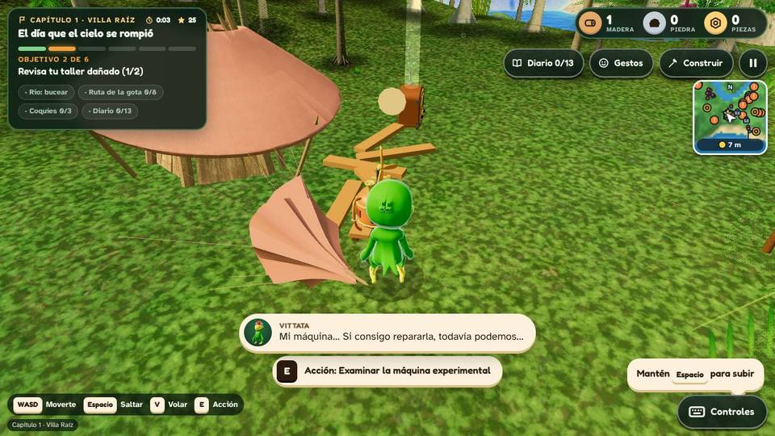
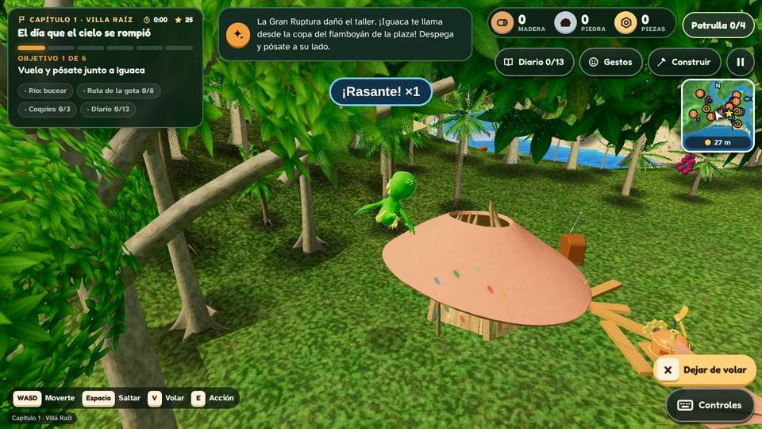

# F4 · Sensación de juego: 20 mejoras pequeñas de «juice»

Claude web B (Fable) · 16-nov-2026 · **solo diseño; no hay código tocado.** Se implementan en N3.

**Cómo lo miré:** recorrí el inicio del cap. 1 (salto, vuelo, picado, aterrizaje, recoger, examinar, cambio de paso), el duelo, el Duelo de 2 y la salida de la Carrera en El Yunque a 1280×720, y leí dónde suena o salta algo en `misiones.js`, `historia.js`, `objetos.js`, `diario.js`, `dialogo.js`, `fisica.js`, `juice.js`, `combate.js`, `duelo2.js`, `retos.js` y `chispa.js`. El navegador de pruebas va lento (GPU por software), así que los tiempos salen del código.

## Lo que ya está bien (no tocar)

- **Vuelo** (`img/f4_02_vuelo_bien.jpg`): tiene inercia (`flyAccel` 3,5), ladeo, rasante con estela, picado con FOV, «¡Remonte!», aterrizaje perfecto, pétalos y polvo al aterrizar (`juice.js`, `fisica.js`).
- **Recoger:** sonido que sube con el combo, plumas, luz y parada de 60 ms (`objetos.js`).
- **Ropa nueva:** cofre, sacudida, vibración y aviso (`misiones.js` `grant`).
- **Carreras y tormenta:** cuenta con sonido, impulso con FOV, golpe con sacudida (`retos.js`). Es el listón para el resto.

## Momentos secos

| Momento | Qué pasa hoy |
|---|---|
| Cumples un paso de la historia | El texto del objetivo cambia de golpe. Sin sonido (`img/f4_01_paso_seco.jpg`) |
| Completas una misión que no da ropa | El «·» pasa a «✓». Nada más |
| Examinas la máquina o el transmisor | Sale un bocadillo. Sin sonido ni chispa (misma captura) |
| Pasas una línea de diálogo | Muda; solo suena al abrirse el diálogo |
| Despegas | Suena `despegar`, pero no se levanta polvo ni hojas |
| Impulso (F) | Suena `dash`, sin rastro en el aire |
| Reúnes todos los materiales | Nada |
| Encuentras algo del Diario | Aviso y ráfaga, pero el botón «Diario 0/13» no se entera |
| Termina el capítulo | Suena y sale el panel; Vittata no celebra |
| Empieza el duelo | «3, 2, 1, ¡Ya!» en silencio |
| Quitas una pluma | Suena `land` (el de aterrizar) y 8 plumas pequeñas |
| Último golpe del duelo | Igual que el primero; la cámara acaba mirando una planta (`img/f1_05_final.jpg`) |
| Adelantas en la carrera | El número del puesto cambia sin más |

## Las 20 mejoras

Sonidos: solo los que ya existen (`assets/audio/sfx/` y los sintéticos de `audio.js`). Todo respeta «Reducir movimiento» (sin sacudida, FOV ni cámara lenta; el sonido y el texto se quedan) y `G.quiet`.

**Esfuerzo:** S = menos de 2 h · M = medio día · L = un día o más.

### Capítulo 1

| # | Mejora | Dónde | Esf. |
|---|---|---|---|
| 1 | **Paso cumplido:** suena `logro`, el tramo de la barra se llena con un barrido de 400 ms y el objetivo nuevo entra deslizando | `src/game/misiones.js` `check()` (donde hace `S.step++`) y `renderQuest()`; `src/ui/ui.css` `#steps li.done` | S |
| 2 | **Misión cumplida sin ropa:** `logro`, ráfaga dorada sobre Vittata y el chip de la misión da un salto (`G.fx.saltar`) | `src/game/misiones.js` `complete()` | S |
| 3 | **Examinar:** `encaje`, 10 estrellas sobre el objeto y parada de 50 ms la primera vez | `content/cap1/historia.js` `examine()` | S |
| 4 | **Diálogo:** tic suave (`boton`) al pasar de línea y rebote de 120 ms del retrato | `src/game/dialogo.js` `nextCaja()` y `nextLibre()`; `ui.css` | S |
| 5 | **Despegue:** polvo y 4 hojas en el suelo al salir (`G.fx.polvo`, `G.fx.hojas`) | `src/engine/fisica.js` `startFlying()` (rama `fromGround`) | S |
| 6 | **Impulso:** 4 plumas detrás, pulso de FOV de +3° durante 0,3 s y `aleteo` | `src/engine/fisica.js` (junto a `play('dash')`); `src/game/juice.js` `paso()` para el FOV | S |
| 7 | **Posarte junto a Iguaca:** Iguaca saluda (clip Welcome, ya existe), caen 6 hojas de la copa y suena `posarse_rama` | `content/cap1/historia.js` `talkLuma()` (paso 0); `G.actores` | M |
| 8 | **Material completo** (p. ej. 4/4 de madera): el contador da un destello dorado y suena `encaje` | `src/game/objetos.js` `renderInv()` | S |
| 9 | **Todos los materiales:** `logro`, los tres contadores saltan en cadena (uno cada 120 ms) y aviso «¡Lo tienes todo!» | `src/game/misiones.js` `check()` (paso con `hasta: { tiene }`) | S |
| 10 | **Refugio construido:** a lo que hay se le suma sacudida suave (0,1 · 0,3 s), polvo en tres puntos de la base y el giro alegre de Vittata (`G.actores.girarAlegre`) | `content/cap1/historia.js` (línea de `play('construir')`) | S |
| 11 | **Diario:** el botón «Diario n/13» salta y el número sube; al 13/13, pétalos y `panel_final` | `src/game/diario.js` `found()` | S |
| 12 | **Fin del capítulo:** 1,2 s antes del panel, Vittata celebra (clip Celebrate) con 30 pétalos; luego entra el panel | `src/game/misiones.js` `showEnd()` | M |
| 13 | **Vuelo a tope:** líneas de velocidad finas en los bordes al pasar del 90 % de la velocidad máxima (las de `retos.js`, sacadas a una función común) | `src/game/juice.js` `paso()`; `src/game/retos.js` «Efectos de velocidad» | M |

### Duelo y Duelo de 2

| # | Mejora | Dónde | Esf. |
|---|---|---|---|
| 14 | **Cuenta atrás con sonido:** `tick` en 3, 2 y 1; `lanzar` en «¡Ya!»; cada número entra con un pop | `src/game/v18/combate.js` `paso()` (bloque `C.cuenta`); `src/game/v18/duelo2.js` `paso()` | S |
| 15 | **Pluma quitada:** `duelo_pata` en lugar de `land`, con el tono un poco más alto cuantas menos plumas quedan; 16 plumas en vez de 8; la pluma del HUD salta y cae | `combate.js` `golpear()` y `pintar()`; `duelo2.js` `golpear()` | S |
| 16 | **Último golpe:** 0,5 s a cámara lenta (el `dtVis` de Combate 2.0 ya lo permite), acercamiento a las dos y `duelo_victoria` en el impacto | `combate.js` `terminar()` y `C2.golpe()`; `duelo2.js` `terminar()` | M |
| 17 | **Poder listo:** `encaje` y un pulso del botón Poder, una vez por carga | `combate.js` `pintarChips()` (ya existe `pulso()`); `duelo2.js` `pintarChips()` | S |
| 18 | **Semilla que falla:** al tocar el suelo, 4 hojas y un poco de polvo; si la rival la esquiva, «¡Uy!» pequeño | `combate.js` `pasoBalas()`; `duelo2.js` `pasoBalas()` | S |
| 19 | **Final del duelo:** la cámara se queda con la ganadora, que celebra; 30 destellos dorados y pétalos; panel de dos líneas | `combate.js` `terminar()` y `devolverCamara()`; `duelo2.js` `terminar()` | M |

### Carreras

| # | Mejora | Dónde | Esf. |
|---|---|---|---|
| 20 | **Adelantar:** al mejorar de puesto, `r_punto` agudo, el «PUESTO» del HUD salta y sale «¡Pasaste a Mango!» (el nombre de la rival) | `src/game/retos.js` (donde se usa `puestoActual()`) | S |

## Orden recomendado

1. **Una tarde, todo S:** 1, 2, 3, 4, 14, 15, 17. Son los que más se repiten en una partida.
2. **Segunda tanda S:** 5, 6, 8, 9, 10, 11, 18, 20.
3. **Los M:** 16 y 19 (van junto al cambio 4 de `F1_VS.md`), 12, 7 y 13.

## Cómo se prueba

- Cada mejora, una comprobación en la batería de su módulo (`AV.missionTest`, `AV.juiceTest`, `AV.v18CombateTest`, `AV.v18Duelo2Test`, `AV.retosTest`): el sonido aparece en `G.audio.log` una sola vez, el contador de `G.fx` sube, y con «Reducir movimiento» no hay sacudida ni FOV.
- Ningún sonido se dobla con uno que ya suena en ese momento (regla de T45).
- Captura antes/después de 1, 3, 15 y 19.
- Rendimiento: ninguna mejora crea mallas nuevas; solo ráfagas de `G.fx` (≤ 30 partículas) y clases CSS.

## Riesgos

- **1 y 2** suenan a menudo: `logro` ya tiene 1,5 s de mínimo entre dos, suficiente.
- **4** puede cansar en diálogos largos: volumen bajo y sin tic si la línea se pasa en menos de 150 ms.
- **12** toca el final del capítulo: no retrasar el panel si `G.quiet` (baterías) ni en la repetición.
- **16** cambia el tiempo visual, no el de juego: la IA y los temporizadores siguen igual.

## Capturas

| | |
|---|---|
|  El objetivo pasa de 1 a 2 y se examina la máquina: no suena ni salta nada |  El vuelo sí responde: «¡Rasante ×1!» |
