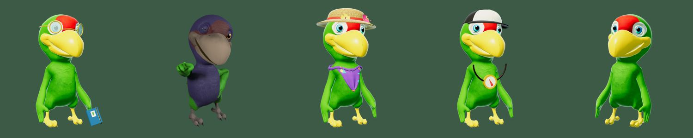

# Para Kelvin · Tres decisiones tuyas, con opciones (F5)

Claude web B (Fable) · 16-nov-2026 · **solo propuestas.** Nada de esto está hecho ni decidido; el juego sigue como está hasta que contestes. Basta con una letra por tema: **1 = A, B o C · 2 = sí / cambios · 3 = 1, 2 o mezcla.**

Corresponden a K1, K2 y K3 de `docs/equipo/LISTA_TERMINADO.md`.

---

## 1. El final de la temporada (cap. 6)

**Lo que pasa hoy.** Se renueva el pacto en el círculo → el Guardián nombra a Vittata «Guardiana del Pacto» y le da su medalla → de noche, en el mirador, Vittata escribe una lista: «La tripulación» → se abre el cómic de cierre → panel final del capítulo. El premio es la pava (la misma del cap. 1).

**Lo que falta.** No hay un momento para *jugar* el final, no hay créditos, no se nota que acabó una temporada entera (se siente como el final de un capítulo más), y lo que el niño decidió en los caps. 2, 3 y 4 no vuelve a aparecer.

**Lo que ya decidiste y ninguna opción cambia:** los seis visitantes, el título «Guardiana del Pacto», la medalla (se gana, va al Cuaderno, sin modelo 3D), los 14 asientos que esperan, el gancho «La tripulación», las dos voces juntas.

### Opción A · «La fiesta del pacto» (final jugable)
Después de la medalla, la plaza se queda en fiesta y **el niño juega 2–3 minutos sin misión**: todos los personajes de la temporada están ahí y cada uno dice una frase sobre lo que el jugador eligió (el sitio de la casa del cap. 2, el nombre de su canoa del cap. 3, el proyecto del cap. 4). Al despegar, la bandada de las especies encontradas vuela con Vittata sobre la isla y **los créditos pasan durante ese vuelo**. Al aterrizar en el mirador: la escena de «La tripulación», el cómic y la tarjeta «Temporada 1 completa».
- **A favor:** es el más divertido y el más «de familia»; premia las decisiones; usa lo que ya existe (bandada, registro de temporada, gestos, música).
- **En contra:** es el que más trabajo pide; hay que escribir unas 12 frases nuevas (tú las apruebas).
- **Coste:** 4–5 días de trabajo. Cero dinero.

### Opción B · «Rumbo a la niebla» (final con gancho)
Todo igual hasta «La tripulación». Entonces, **desde la niebla responde una luz**: uno de los 14 asientos vacíos se enciende solo. Vittata y la tripulación suben a la canoa del jugador (con el nombre que le puso) y salen hacia la niebla; **los créditos pasan sobre el mar**. Última imagen: las dos voces, «Busquen a los que quedan…», y el título «Temporada 2 · Las islas olvidadas».
- **A favor:** deja con ganas de la temporada 2; corto; emocionante.
- **En contra:** promete una temporada 2 con fecha que no tenemos; cambia un detalle del guion actual (hoy «de la niebla no responde ninguna luz nueva»), así que es **cambio de canon**; menos juego, más escena.
- **Coste:** 2–3 días. Cero dinero.

### Opción C · «El cómic de legado» (final tranquilo)
El final es el cómic del propio niño: **una doble página de la temporada**, armada con sus viñetas de los seis capítulos y sus decisiones. El Guardián la «lee» en voz alta en el círculo; la última página son los créditos. Se puede descargar (como el cómic familiar).
- **A favor:** el más barato y seguro; es único de cada niño; encaja con «cómic de legado» de la biblia.
- **En contra:** es para mirar, no para jugar; depende de que el niño haya jugado los seis capítulos en el mismo dispositivo.
- **Coste:** 1,5–2 días. Cero dinero.

| | A · Fiesta | B · Niebla | C · Cómic |
|---|---|---|---|
| Se juega | sí | poco | no |
| Aparecen las decisiones del niño | sí | la canoa | sí |
| Cambia el canon | no | **sí** (la luz) | no |
| Trabajo | 4–5 días | 2–3 días | 1,5–2 días |

Se pueden combinar: A y C comparten la doble página; B solo aporta la luz, que es la parte de canon.

**Dos cosas que hacen falta con cualquiera de las tres:**
- **Créditos.** Los nombres del equipo van solo en la web, por tu decisión. Propuesta: en el juego, «Hecho en Puerto Rico por el equipo de Amazona Verse», el agradecimiento a las fuentes (USFWS, DRNA, USGS) y un botón «Ver los créditos» que abre la web. ¿O quieres los nombres también dentro del juego?
- **Premio único de temporada.** Algo que no se consiga de ninguna otra forma. Propuestas: **(a)** el Traje de Guardián en un color nuevo, dorado, «Traje de la Guardiana del Pacto» (el modelo ya existe; solo es un color); **(b)** una plantilla de Construir, «El círculo de los 36», para el rincón del niño; **(c)** las dos.

---

## 2. Premios por capítulo, sin repetir

**El problema, en una tabla.** Hoy se repiten 10 de los 21 premios de los caps. 2 a 6 (en **negrita**):

| Cap. | Premios de hoy |
|---|---|
| 1 | botas azules · pava roja · guayabera · gorra de la bandera · maracas · camisa 787 · lentes dorados · lentes de la Campeona |
| 2 | lentes binoculares · cuaderno · casco de constructor · botas de constructor · mapa |
| 3 | casco marinero · bandera · sombrero de pescador · **mapa** |
| 4 | **lentes binoculares · cuaderno · casco de constructor · mapa** (los cuatro repetidos) |
| 5 | linterna · lupa · **bandera** · **mapa** |
| 6 | **mapa** · **cuaderno** · **pava roja** · mapa de las islas |

**Propuesta.** Usa solo ropa que ya existe en el ropero (sin arte nuevo). El cap. 1 no cambia. Cada premio tiene que ver con lo que se hace en esa misión.

| Cap. | Misión 1 | Misión 2 | Misión 3 | Cuaderno completo |
|---|---|---|---|---|
| 2 · Un lugar para todos | Lentes binoculares *(igual)* | Cuaderno de campo *(igual)* | Casco y botas de constructor *(igual)* | **Martillo** *(antes: mapa)* |
| 3 · Más allá de la bahía | Casco marinero *(igual)* | **Máscara de buceo** *(antes: bandera)* | Sombrero de pescador *(igual)* | Carta de la bahía (mapa) *(igual; es el único mapa)* |
| 4 · El precio del progreso | **Chancletas** *(mirar la orilla)* | **Gorra criolla de paja** *(escuchar a todos)* | **Mochila PR** *(construir lo acordado)* | **Pantalón de mezclilla** |
| 5 · Las voces olvidadas | Linterna *(igual)* | Lupa *(igual)* | Bandera de Puerto Rico *(igual; es la única bandera)* | **Lentes redondos** *(antes: mapa)* |
| 6 · El pacto de los 36 | **Coquí de peluche** *(regalo de un visitante)* | **Camisa hawaiana** *(la de la fiesta)* | **Pava azul** *(la de la fiesta, otro color)* y **cuatro puertorriqueño** | Mapa de las islas que faltan *(igual)* |
| Temporada completa | | | | Premio único (punto 1) |

**Avisos.**
- **La pava del cap. 6 la decidiste tú (4-nov).** La propuesta la respeta, pero en azul, para que no sea la misma del cap. 1. Si la prefieres roja, se queda roja.
- **La «bandera de señales» del cap. 3 es hoy la bandera de Puerto Rico** con otro nombre. La propuesta la quita del cap. 3 y la deja solo en el cap. 5, donde sí es la bandera.
- **Variante barata:** si prefieres que el cap. 4 siga con el tema de obra, el casco y los lentes pueden ser los mismos en otro color (casco anaranjado). Es menos trabajo, pero se nota menos.
- **Antes de aplicar** hay que comprobar que ninguna de estas piezas es hoy libre en el creador: un premio no puede quitarle a un niño algo que ya lleva puesto. Si alguna lo es, se premia un color nuevo de esa pieza.
- **Sin tocar:** el Mercadito (conchitas) y los premios del cap. 1.
- **Trabajo:** medio día (son datos de cada capítulo y sus pruebas) más el inglés.

---

## 3. Arte de Iguaca, el Guardián, la Abuela y el Papá

**Cómo están hoy.** En el mundo son **recortes planos** (una imagen que siempre mira a la cámara) al lado de una Vittata en 3D. Se nota sobre todo al volar alrededor de ellos y en el teléfono.



*De izquierda a derecha: Iguaca, el Guardián, la Abuela, el Papá y Vittata.*

**Lo importante de esta imagen:** Iguaca, la Abuela y el Papá **ya son fotos del modelo 3D de Vittata** con accesorios (lentes y cuaderno; sombrero y pañuelo; gorra y brújula). Solo el Guardián es otro modelo.

### Opción 1 · En 3D, con el modelo que ya tenemos
Los tres vittata salen en el mundo como cotorras 3D de verdad: el mismo cuerpo, sus accesorios, y cada uno con su tamaño, su postura y su ritmo (la Abuela más baja y pausada; el Papá más alto; Iguaca serena). Es lo mismo que ya hacen las rivales de las carreras y los personajes de V18. **Vittata no se toca:** se usa una copia de su modelo, como ya se hace.
- **A favor:** desaparece el «cartón» junto a Vittata; se mueven, miran, respiran y pueden hacer gestos; coste bajo; los retratos de diálogo siguen valiendo.
- **En contra:** los cuatro comparten la silueta joven de Vittata: la edad se cuenta con accesorios, tamaño y movimiento, no con el cuerpo. Tres cotorras 3D más en pantalla pesan algo en el teléfono (se resuelve con el modelo ligero que ya existe).
- **El Guardián:** su modelo propio hay que tenerlo en 3D dentro del juego. Si el archivo existe (es de donde salió su retrato), se convierte; si no, mientras tanto usa el cuerpo común con la piel de *imperialis*, que ya está en el Álbum, y más tamaño.
- **Coste:** 3–4 días de trabajo. Cero dinero. De ti: aprobar las cuatro fotos, y el archivo 3D del Guardián si lo tienes.

### Opción 2 · Marco ilustrado (seguir en 2D, pero a propósito)
No se modela nada. Los personajes dejan de fingir que son 3D: en el mundo aparecen como **estampas ilustradas** con borde, sombra y un leve balanceo (estilo cómic, como el Cuaderno), y al hablar su retrato sale en una viñeta con marco. El recorte deja de parecer un error y pasa a ser un estilo.
- **A favor:** lo más rápido; cero riesgo de rendimiento; une el mundo con el cómic; no hay nada que rehacer si luego llegan modelos definitivos.
- **En contra:** siguen sin moverse ni poder hacer gestos; al lado de Vittata 3D siguen siendo de otro mundo (ahora con intención); no arregla lo que tú notaste, lo disimula.
- **Coste:** 1–1,5 días. Cero dinero. De ti: aprobar el estilo del marco.

### Por personaje

| Personaje | Opción 1 · 3D | Opción 2 · Marco |
|---|---|---|
| **Iguaca** (vittata, madura y serena) | Cuerpo común + lentes redondos + cuaderno. Tiene que distinguirse de Vittata de lejos: propuesta, un tono de pluma algo más oscuro (pide tu sí; hoy son iguales) | Estampa con sus lentes y su cuaderno |
| **Guardián** (*imperialis*, mayor) | Su modelo si existe el archivo; si no, cuerpo común con piel *imperialis*, más grande y lento | Estampa con su render actual, que es el más distinto y el que mejor queda en marco |
| **Abuela** | Cuerpo común + sombrero de paja + pañuelo violeta, más baja, movimientos pausados | Estampa |
| **Papá** | Cuerpo común + gorra hacia atrás + brújula, más alto | Estampa |

| | Opción 1 · 3D | Opción 2 · Marco |
|---|---|---|
| Arregla el «cartón» | sí | lo convierte en estilo |
| Se mueven y gesticulan | sí | no |
| Trabajo | 3–4 días | 1–1,5 días |
| Riesgo | rendimiento en el teléfono (bajo) | que siga sin gustarte |
| Sirve si luego haces modelos propios | sí: se cambia el modelo y queda todo lo demás | sí: se retira el marco |

**Mezcla posible:** Opción 1 para Iguaca, la Abuela y el Papá (ya son el modelo), y Opción 2 para el Guardián hasta que su 3D esté en el juego.

**Tercer camino, que es solo tuyo:** modelos propios para cada uno, hechos por ti o por el equipo de arte. Es lo mejor a la larga y lo más lento; ninguna de las dos opciones lo estorba.

---

## Cómo contestar

```
1 (final):   A / B / C / mezcla: ___     Créditos: sin nombres / con nombres     Premio único: a / b / c
2 (premios): sí / cambios: ___            Pava cap. 6: azul / roja
3 (arte):    1 / 2 / mezcla               ¿Tienes el 3D del Guardián?: sí / no
```
