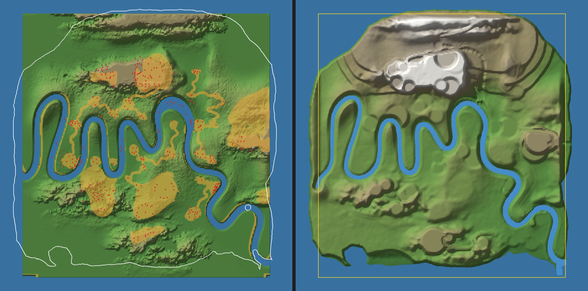

# Mapa completo: el terreno original de Kelvin frente al del juego (25-oct-2026)

Kelvin: «el mapa no está completo; se llamaba Amazona por algo importante; también estaba el área del río Amazonas».
Se leyó `04_Mapa_3D/AV3DMaxTerrainExport.max` (135 MB) por streaming, sin 3ds Max, con `tools/blender/mapa_original_diag.py`. El script reutiliza `edificios_maxscene.py` y saca las cifras y las tres capturas de abajo.

Izquierda: el terreno original entero a la escala del juego. En azul, el río; en naranja, las sendas y claros sin árboles de su máscara de bosque; en rojo, los 376 edificios de Kelvin; en blanco, la costa de la isla del juego. Derecha: el juego, con el rectángulo del original en amarillo. Más capturas: `mapa_original_vs_juego_relieve.png` (rojo: el juego sube el relieve; azul: lo baja) y `mapa_original_vs_juego_bosque.png`.

## 1. Qué tiene el .max (todo, por clase)
La escena tiene 2561 objetos y **17 nodos**. No hay capas, grupos ni nodos ocultos con geometría.

| Nodo | Clase | Qué es |
|---|---|---|
| `TerrainBuilderSurface` | Editable Poly (40 401 vértices, 40 000 quads) | **El único terreno.** Una rejilla de 201 × 201 que va de −896 a 896 (x) y de −960 a 960 (y) unidades, con alturas de 0 a 154,5. Es exactamente `mapa_base_kelvin.npy` (diferencia ≤ 0,06 u) |
| `WATER OCEAN` | Box (±1086 × ±1387 u) con FFD, Noise, 3 Displace y UVW | El mar alrededor; el agua del río es este mismo plano, que asoma por el cauce (cota 0) |
| `MultiScatter_002` | MultiScatter (cantidad 2 000 000, sobre el terreno) | El bosque. Su máscara es `WORK/Amazonas/maps/trees.psd`: negro = sin árboles |
| `nature1/4/5` y 7 `Archmodels61_*` (roble, coco de mar, limonero…) | Editable Poly (de 0,7 k a 280 k caras) | Los 10 árboles fuente del scatter, aparcados fuera del mapa (x ≈ 600, y ≈ 1150–1220) |
| `VRaySun001`, `Camera001` y sus `Target` | Luz y cámara | Render de V-Ray |

Las texturas de `CityBuilderPlugin` (BluePrints, Water_Normal, palmeras) son materiales del plugin. **En esta escena no hay ciudad, edificios ni un «río Amazonas» aparte.** La ciudad está en `AV3DMaxExportBuildings.max` (ver `EDIFICIOS.md`).

## 2. Qué parte del original está en el juego
| Medida | Original (a 0,255 m/u, como el juego) | Juego |
|---|---|---|
| Extensión | 457 × 490 m (22,4 ha) | Isla de 20,6 ha |
| Huella del original dentro de la isla | — | **88,7 %**; el 11,3 % restante es mar (franja sur, esquinas y el borde este del río) |
| Relieve igual (±3 m) | — | 7,6 % (subido > 3 m: 59,6 %; bajado: 0,9 %) |
| Río | 1366 m de largo, unos 11 m de ancho; entra por el borde oeste y sale por la esquina sureste | «Río de los Meandros»: 1404 m de largo, 8,3 m de ancho; nace en la Cueva del Río y desemboca en el mar |
| Bosque | 2 M de instancias de Archmodels; el 23 % del terreno sin árboles (río, sendas y claros) | Flora propia (rejilla de 8 m), sin las sendas del original |

**Conclusión:** el juego no recortó un trozo del mapa. Usa el 100 % de la huella del terreno original, aunque la retocó mucho.
- **El río Amazonas es el río que ya está en el juego** (los meandros). El archivo se llamaba `E:\WORK\Amazonas` por él.
- No hay otra región del río en ningún archivo.

## 3. Qué falta o cambió, por zonas
| Zona | Original | Juego | Qué se perdió |
|---|---|---|---|
| Norte (mesetas en franja) | Cordillera de tepuyes con paredes verticales | Terrazas de palma, El Yunque (98 m) y Los Picachos | Las mesetas planas tipo tepuy (rojo intenso en `_relieve`) |
| Meseta central norte | Tepuy grande junto al primer meandro | Absorbida por las terrazas y el yunque | Su silueta propia |
| Río (Amazonas) | Ancho, cruza el mapa de borde a borde | 25 % más estrecho, con nacimiento y final inventados | La sensación de río grande que viene de fuera y sigue de largo |
| Sendas y claros | Red de senderos de tierra que une **claros donde están las aldeas de Kelvin** (los puntos rojos caen en los claros naranjas) | Senderos propios (A*), con otro trazado | El trazado original de sendas entre aldeas (15,6 % del mapa) |
| Bordes sur y sureste | Llano y mesetas bajas hasta el borde | Mar, playa, Bahía Bio y arrecife | El 11 % del terreno (es lo que hace isla al mapa) |
| Este (meseta oriental) | Tepuy cortado por el borde | Mesa del Este | Se conserva |

## 4. Fase 2: por qué no se implementó
El encargo pedía meter la primera región que faltara solo si era clara y no rompía nada. **No hay ninguna región que falte en el .max:** todo su terreno ya está bajo la isla. Una región nueva del «río Amazonas» sería contenido nuevo, y además el motor hoy es un solo mapa:
- `terreno.js` define `WORLD = min(ancho, largo) / 2 − 6`;
- hay una sola rejilla de alturas y de triángulos de ±264 m;
- y una sola rejilla de flora y de agua.

Meter otra región exige reestructurar el mundo. Por eso se deja como propuesta.

## 5. Propuesta por fases (decide Kelvin)
**Fase A: dentro de la isla, sin tocar el motor (riesgo bajo).**
- A1. Pasar las sendas y claros de `trees.psd` a la máscara `libre` de la flora y a senderos de tierra. Es el trazado de Kelvin entre sus aldeas.
- A2. Ensanchar el río hacia sus 11 m originales donde no haya puentes ni misiones.
- Se toca `mapa_lib.py` y se regeneran los datos del mapa. La descarga no crece.
- Antes hay que coordinarlo con el dueño de `vegetacion.js`.
- **Hecha (R1, 26-oct-2026):** 1,9 km de sendas de Kelvin (`mapa_sendas_kelvin.py` → `.json`) pintadas de tierra y fuera de la máscara `libre`, sin copas encima; el río, rebautizado «Río Amazonas», pasa de 8,3 a 11,1 m de ancho medio (el cañón del puente queda igual). No hizo falta tocar `terreno.js` ni `vegetacion.js`. Capturas: `img/r1_sendas_antes.jpg`/`_despues.jpg` y `img/r1_rio_antes.jpg`/`_despues.jpg`.

**Fase B: región «Río Amazonas», a la que se llega volando (requiere aprobar la arquitectura).**
- **Qué es:** el terreno original **sin retocar**: sus tepuyes y su río de borde a borde.
  - Opción 1: a escala real de río grande. A 1 m/u serían 1,8 × 1,9 km, con un río de unos 44 m de ancho y 5,4 km de largo.
  - Opción 2: a la escala actual, como «la otra orilla».
  - **Decisión de Kelvin (canon):** escala, nombre y si la isla y la región se ven como el mismo lugar. Ojo: el relieve es el mismo que el de la isla.
- **Acceso:** una ruta de vuelo (`rutasVuelo` / `corrientes`) desde el borde oeste de la isla, donde el río original sigue. Un fundido de niebla tapa el cambio.
- **Motor (propuesta, no hecho):**
  1. `G.regiones`: cada región con origen, tamaño, alturas, malla, agua y flora propios. `height()`, `WORLD` y el minimapa consultan la región activa.
  2. Streaming por región: se carga el paquete al entrar en un radio de 150 m del portal y se libera a más de 600 m. Se reutiliza el patrón de `streaming.js`.
  3. LOD del terreno: 201² cerca, 101² a media distancia y 51² lejos, en celdas de 256 m.
  4. Colisiones: la rejilla de triángulos de cada región.
  5. Prueba `regionesTest`: carga, descarga, altura continua en el portal, isla intacta y presupuestos.
- **Presupuesto para móvil:**
  - descarga inicial **igual** que hoy;
  - paquete de región ≤ 1,5 MB comprimido (terreno con LOD ~0,6 MB, alturas Uint16 ~80 KB, agua ~100 KB, flora ~150 KB e impostores de árbol reutilizados);
  - +40 MB de GPU como máximo y +60 draw calls;
  - ≥ 30 FPS en un móvil medio y 60 en escritorio;
  - con la región activa, la isla baja a su LOD lejano.

**Fase C:** las aldeas originales sobre los claros de la región, con los modelos de `assets/models/edificios`, y misiones del episodio 2 allí (decisión de contenido).

## Pendiente para Kelvin
1. ¿El «área del río Amazonas» es este mismo río (ya en el juego) o una región más grande? Si es región: escala (opción 1 o 2) y nombre.
2. ¿Se aprueba el cambio de arquitectura de la Fase B (mundo con regiones)?
3. ¿Se hace ya la Fase A (sendas de Kelvin y río más ancho en la isla)?
