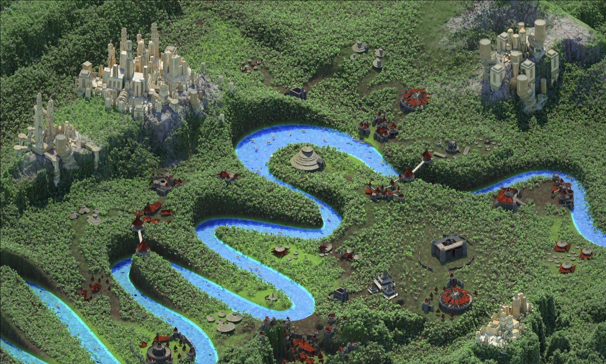

# Mapa completo: inventario del original, por qué se ve «hueco» y plan por fases (26-oct-2026)

Auditoría de la sesión de Claude Fable (solo lectura y capturas; nada implementado). Kelvin: «el mapa… eso es un pedazo solamente de todo el mapa, era gigante. Había ciudades, distintas ciudades, creo que eran 13… y se ve como si fuera todo hueco». Prioridad: pulir lo que se ve, terminar la historia y que el móvil corra fluido; sin minijuegos nuevos. Las decisiones de Kelvin van marcadas **[KELVIN]** y reunidas en § 6.

**En seis líneas.**
1. **No hay más mapa que el que ya está.** Los dos `.max` de Kelvin (terreno y edificios) son la única fuente; el juego usa el 100 % de la huella del terreno y 376 de las 377 piezas. No existe ningún archivo, doc, captura ni web con «13 ciudades».
2. **Las «13 ciudades» son los 14 asentamientos del render de enero de 2022:** 4 ciudades de piedra (KitBash3D Ancient Temples) y 10 aldeas de madera y paja (KitBash3D Savage), hoy repartidos en 14 zonas del juego. La cuenta de memoria de Kelvin es correcta en orden de magnitud.
3. **Lo «gigante» era el bosque, no la extensión:** el original tenía 2 000 000 de árboles (MultiScatter) sobre 22 ha, un dosel cerrado donde no se ve el suelo. El juego tiene unos **1 900 árboles** (≈ 90 por hectárea) y un suelo verde liso: por eso se ve hueco.
4. Además el juego está al **84 % de la escala** del .max (0,255 m/u frente a 0,3048), recortó el 11 % del terreno para hacerlo isla y no muestra las ciudades de piedra con su textura más allá de 90 m (se ven beige, «de cartón», desde el aire).
5. El plan tiene 5 fases: F0 arreglos rápidos (2 semanas), F1 bosque lleno, F2 cada ciudad con cara y nombre, F3 motor por regiones con presupuesto por dispositivo, F4 mundo más grande (opcional, decisión de canon). Las fases F0 a F2 no tocan la arquitectura ni la descarga inicial.
6. Las ciudades ya tienen sitio en los 6 capítulos de la temporada 1 (§ 5): no hace falta inventar lugares, hace falta nombrarlos y llenarlos.

---

## 1. Inventario del mapa original

### 1.1 Fuentes revisadas
| Fuente | Qué aporta |
|---|---|
| `04_Mapa_3D/AV3DMaxTerrainExport.max` (135 MB, 17 nodos) | El único terreno: `TerrainBuilderSurface`, rejilla 201 × 201 (−896…896 × −960…960 u, alturas 0…154 u), el mar `WATER OCEAN`, el `MultiScatter_002` con **2 000 000** de instancias de 10 árboles Archmodels y su máscara `trees.psd` (23 % del terreno sin árboles: río, sendas y claros) |
| `04_Mapa_3D/AV3DMaxExportBuildings.max` (2,4 GB, 1828 nodos) | Las 377 instancias de 74 modelos KitBash3D (Ancient Temples y Savage) más canoas y losas. Ya migrado a `04_Mapa_3D/migrado/escena_layout.json` y al kit web (`docs/EDIFICIOS.md`) |
| `09_Capturas_Investigacion/Screen Shot 2022-01-28 at 3.34.21 PM.png` y `3.44.43 PM.png` | **El render completo de la escena de Kelvin (ene-2022):** es la foto del «mapa gigante». Copia: `docs/img/mapa_audit_original_2022.jpg` |
| `02_Web_Marca`, `06_Textos_Ideas_Docs`, `Web/`, `Pitch/`, `CONTEXTO_PARA_PROMPT.md`, `LEEME.md` | Marca, pitch 2022 (equipo de 4, NFT), especies. **Ninguno habla de ciudades ni de regiones** |
| `docs/equipo/MAPA_COMPLETO.md`, `docs/EDIFICIOS.md`, `docs/STORY_BIBLE.md`, `docs/CANON_REGISTRY.md` | Diagnóstico del terreno (25-oct), kit de edificios, canon («islas que estuvieron conectadas hasta la Gran Ruptura») |
| `grep -ri "13 ciudad\|trece\|ciudades"` en todo `~/AmazonaVerse` | **Una sola aparición:** la cita de Kelvin en `PEDIDOS.md` (26-oct). No hay lista, nombres ni mapa de 13 ciudades en ningún archivo |

### 1.2 El terreno
- Extensión a la escala del .max (0,3048 m/u): **546 × 585 m, 32 ha**. A la escala del juego (0,255 m/u): 457 × 490 m, 22,4 ha. Es un rectángulo continental: el río entra por el oeste y sale por el sureste; no había mar ni costa (el `WATER OCEAN` es el plano del agua que asoma por el cauce).
- Relieve: cordillera de tepuyes de paredes verticales al norte (donde están las dos ciudades de piedra grandes), tepuy oriental, mesetas bajas al sur y un llano central con el río de meandros (1366 m de largo, unos 11 m de ancho).
- Bosque: 2 M de instancias de Archmodels 61 (roble, coco de mar, limonero…) y `nature1/4/5`. Dosel cerrado; el suelo solo se ve en las sendas, los claros de las aldeas y las orillas.
- Sin ciudad, texturas ni «río Amazonas» aparte (ya comprobado en `MAPA_COMPLETO.md` § 1).

### 1.3 Los asentamientos: esto son las «13 ciudades»
Agrupando las 377 instancias por cercanía (radio 30–40 m, sin canoas) salen **13 a 16 grupos**, y en el render de 2022 se cuentan a ojo **14**: 4 de piedra y 10 de madera. El juego los conserva como 14 zonas (`assets/data/escena_kelvin_cap1.json`, `zonasEdificios`). Posiciones en metros del juego (x este, z sur, origen en el centro de la isla).

| # | Zona en el juego (`id`) | Nombre hoy en el minimapa | Kit | Piezas | Dónde | Tamaño | Qué era en el render de 2022 |
|---|---|---|---|---|---|---|---|
| 1 | `kelvin_ruinas_yunque` | Ruinas de Kelvin · El Yunque | Ancient (53) + 4 losas | 57 | (−4, −131), cumbre a 97 m | 93 × 88 m | **La gran ciudad de torres** sobre el tepuy del noroeste: templos A, B, E y F, 8 muros, 7 portales, 12 torres. La «ciudad tipo Asgard» |
| 2 | `kelvin_ruinas_yunque_2` | Ruinas de Kelvin · El Yunque | Ancient (19) + bloques | 23 | (−74, −132), 96 m | 38 × 48 m | **La ciudad-mirador** del promontorio oeste: 7 miradores, 6 pilares, templo grande B |
| 3 | `kelvin_aldea_rio_este_2` | Aldea de Kelvin · el río del este | Ancient (11) + Savage (18) | 29 | (136, 13), Mesa del Este | 38 × 28 m (piedra) | **La ciudad del tepuy oriental:** templo D, 3 medianos H y 7 torres, con bohíos y caney al pie |
| 4 | `kelvin_aldea_colina` | Aldea de Kelvin · la Colina | Ancient (complejo de 12 templos) + carpas y losas | 22 | (−5, 141), 21 m | 51 × 35 m (complejo) | **La ciudad del sur** (esquina sureste del render): el complejo de ruinas con sus losas y carpas |
| 5 | `kelvin_aldea_rio_este` | Aldea de Kelvin · el río del este | Savage | 42 | (112, 97), 8 m | 45 × 28 m | Aldea amurallada de 13 bohíos y empalizadas junto a Villa Raíz (la del inicio) |
| 6 | `kelvin_aldea_rio_oeste` | Aldea de Kelvin · el río del oeste | Savage + 8 canoas | 35 | (−134, 27), 16 m | 117 × 38 m | Aldea ribereña con murallas-atalaya, carpas y embarcadero |
| 7 | `kelvin_aldea_lomas` | Aldea de Kelvin · las Lomas del Oeste | Savage | 34 | (−87, 91), 17 m | 77 × 63 m | **El fuerte de las 11 torres vigía** (torres, muros de roca, carpas) |
| 8 | `kelvin_aldea_mina` | Aldea de Kelvin · La Mina | Savage + 3 torres de piedra + 7 canoas | 25 | (78, −106), 21 m | 13 × 10 m + canoas | Aldea del embarcadero del norte, con tres torres antiguas |
| 9 | `kelvin_aldea_meandros` | Aldea de Kelvin · los meandros | Savage + 9 canoas | 25 | (−14, 17), 13 m | 27 × 50 m | Los bohíos de la península del meandro (el gran caney redondo del centro del render) |
| 10 | `kelvin_aldea_mina_2` | Aldea de Kelvin · La Mina | Savage + 6 canoas | 23 | (96, −43), 10 m | 49 × 23 m | Monumentos A y murallas junto al río |
| 11 | `kelvin_aldea_rio_este_3` | Aldea de Kelvin · el río del este | Savage | 21 | (38, 52), 20 m | 82 × 74 m | **Los puentes y portales**: 6 puentes de madera y 9 portales que cruzan los meandros |
| 12 | `kelvin_aldea_rio_oeste_2` | Aldea de Kelvin · el río del oeste | Savage | 18 | (−134, −41), 21 m | 23 × 18 m | Campamento de 13 toldos pequeños |
| 13 | `kelvin_aldea_yunque` | Aldea de Kelvin · El Yunque | Savage | 11 | (−21, −70), 27 m | 85 × 51 m | Murallas y torres al pie del tepuy |
| 14 | `kelvin_aldea_meandros_2` | Aldea de Kelvin · los meandros | Savage | 11 | (−74, −68), 33 m | 28 × 28 m | Los 4 monumentos A y carpas de la ladera norte |

Notas:
- Siete zonas comparten nombre de dos en dos («el río del este» ×3, «La Mina» ×2…). **En el minimapa hoy no se distinguen 14 lugares, se leen 7.** Eso también contribuye a que el mapa parezca más pequeño de lo que es.
- Las canoas (32) y las losas, bloques y plataformas (17) están todas; la única pieza descartada (`ancient_largej_sculptmd`) es una caja vacía fuera de la escena.
- **¿Hogares por especie?** Se buscó la pista en todo el proyecto: no hay ninguna relación entre asentamientos y las 36 especies de *Amazona* en archivos, nombres de nodos (`Box042`, `Group001`…), capas ni docs. Los nombres del .max son los de KitBash3D. Si Kelvin quiere que cada ciudad sea el hogar de una especie o de un grupo de guardianes, es **canon nuevo** (§ 6, K3).

---

## 2. El original frente al juego de hoy (build `mapa-audit`, HEAD e14d6e7)

### 2.1 Qué se usa y qué falta
| Elemento | Original | Juego hoy | Veredicto |
|---|---|---|---|
| Huella del terreno | 32 ha (546 × 585 m a 0,3048 m/u) | Isla de 20,6 ha a 0,255 m/u; el 88,7 % de la huella del original cae en tierra, el 11,3 % (franja sur, esquinas, borde este del río) se hizo mar | **Se usa todo, al 84 % de escala.** No hay «pedazo» que falte |
| Relieve | Tepuyes de pared vertical al norte, meseta oriental, llano sur | Mismas alturas base (`mapa_base_kelvin.npy`), con terrazas, El Yunque (98 m), Picachos, costa y cauces encima; 60 % del terreno subido más de 3 m | Se conserva la estructura; las siluetas planas de tepuy quedaron absorbidas por las terrazas |
| Río | 1366 m × 11 m, de borde a borde | «Río Amazonas» 1404 m × 11,1 m (R1 lo ensanchó), con nacimiento en cueva y desembocadura | Igual |
| Sendas y claros | Red de tierra entre aldeas (15,6 % del mapa) | 1,9 km de sendas de Kelvin (R1) + senderos A* | Hecho en R1 |
| Asentamientos | 14 (377 piezas) | 14 zonas (376 piezas), 64 modelos web con LOD lejano y `_hd` | **Todo está**, pero con 7 nombres para 14 lugares |
| Bosque | 2 000 000 de árboles, dosel cerrado | ≈ 1 870 árboles + 610 helechos gigantes + 5 600 plantas, rocas y troncos (`mapa_cap1.js` → `flora.densidad`, 8 056 instancias) | **Aquí está el hueco:** mil veces menos árboles; 90 por hectárea donde el original tenía dosel continuo |
| Suelo | Nunca se ve | Verde liso (splat de pasto) con manchas rojas de hojarasca, visible desde cualquier altura | Lee como césped, no como selva |
| Mar | No había | Isla rodeada de mar | Decisión de diseño (canon: islas tras la Gran Ruptura). Hace que el mapa se sienta «un pedazo» |

### 2.2 Por qué se ve «hueco»: causas medidas, por orden de peso
1. **Flora escasa (causa principal, 70 % del efecto).** Datos de `assets/data/mapa_cap1.js`: palma de sierra 797, tabonuco 635, yagrumo 215, bambú 157, tabonuco enano 57, flamboyán 7, **ceiba 0**. La máscara de celdas de 8 m tiene árboles en 1 270 de 4 356 celdas (palma) y 1 519 (tabonuco): **dos tercios de la isla no tienen ningún árbol**. Y la densidad baja por calidad: `renderer.js` `flora: 0.8` en medio (móvil) y `0.5` en bajo.
2. **Distancia de dibujo de la flora.** `vegetacion.js` `DIST = { arbol: 110, impostor: 520, planta: 55 }` multiplicado por `floraDist` (1 / 0,8 / 0,55): en el móvil los árboles de verdad llegan a 88 m y los impostores a 416 m; en bajo, 60 y 312 m. Las plantas (helechos, heliconias, bromelias) desaparecen a 44–30 m. Desde el aire a más de 500 m **no se dibuja ningún árbol** (captura cenital: isla verde lisa).
3. **El suelo se ve.** Con el dosel abierto, el splat verde uniforme más las manchas rojas de hojarasca dominan la imagen aérea. El original no enseñaba suelo salvo en sendas y claros.
4. **Las ciudades de piedra se ven beige a media distancia.** El `_hd` con el atlas de 16 texturas entra solo a 45/70/90 m (`CFG.hd`); el ligero usa 6 texturas de 512 px en caja y el lejano es color de vértice. A 100 m la cumbre de El Yunque es una masa color arena sin frisos ni sombra propia (`mapa_audit_yunque_ruinas.jpg`). Grok ya está en esto (G6, lotes `_hd`).
5. **Cumbre pelada.** La meseta plana de 97 m que se hizo para asentar la ciudad (QA-28) tiene unas matas de hierba y nada más; el tepuy del render estaba cubierto de selva hasta el borde del acantilado.
6. **Un nombre para dos o tres lugares** (§ 1.3): el jugador no percibe 14 destinos.
7. **La niebla no es la causa:** `niebla: [40, 1000]` con altura `[8, 70]`; el `far` es 1600 m. Tampoco los edificios sin cargar: desde 7b72f4e las 17 zonas (14 de Kelvin + 3 propias) se ven desde cualquier punto.

### 2.3 Capturas (build HEAD e14d6e7, `tools/build/look_capturas.py` con vistas propias, calidad alto en escritorio; móvil emulado 390 × 844 dpr 2 con calidad automática)
Capturas en `docs/img/mapa_audit_*.jpg`. Las cifras son del cuadro entero; el Chrome sin interfaz de la Mac M4 da 60 FPS en todo, así que **el FPS no dice nada del móvil real**: lo que sí dicen son los triángulos, los draw calls y las texturas.

| Vista | Archivo | Escritorio (alto): calls · tris | Móvil emulado: calls · tris · calidad | Qué se ve |
|---|---|---|---|---|
| Cenital, 560 m | `mapa_audit_aerea_cenital.jpg` | 42 · 369 k | 42 · 200 k · medio | Isla verde lisa, río, manchas rojas, ciudades beige. **Cero árboles** |
| Desde el sur, 250 m | `mapa_audit_aerea_sur.jpg`, `mapa_audit_movil_aerea_sur.jpg` | 75 · 320 k | 59 · 230 k · medio | Palos blancos sueltos (impostores), suelo visible en toda la isla; las dos ciudades del norte como bloques arena |
| Desde el sur, 190 m (móvil) | `mapa_audit_movil_aerea.jpg` | — | 61 · 258 k · medio | Igual, en vertical |
| Villa Raíz desde el aire | `mapa_audit_villa_aire.jpg` | 117 · 326 k | 68 · 196 k · medio | La parte más llena del mapa: arboleda, playa, aldea. Aun así, claros grandes de césped |
| Villa Raíz a pie | `mapa_audit_villa_suelo.jpg`, `mapa_audit_movil_villa.jpg` | 126 · 439 k | 85 · 304 k · medio | **Bien:** bohío, flamboyán, ceiba, bambú. A pie el mapa no se ve hueco cerca de la Villa |
| Aldea del río del oeste | `mapa_audit_rio_oeste.jpg` | 128 · 1 023 k | 80 · 387 k · medio | Aldea con textura, palmas y río; el fondo (lomas) con palos y césped |
| Lomas del Oeste | `mapa_audit_lomas.jpg` | 114 · 921 k | 87 · 470 k · medio | Torres y carpas; la loma de alrededor casi sin árboles |
| La Mina y aldea del río este 2 | `mapa_audit_mina.jpg` | 115 · **1 523 k** | 85 · 994 k · medio | La vista más cargada (cascada, acantilados, dos zonas) |
| Ruinas del este (Mesa del Este) | `mapa_audit_este_ruinas.jpg`, `mapa_audit_movil_este.jpg` | 118 · 1 179 k | 98 · 425 k · medio | Templo D y torres beige en la mesa; abajo arboleda rala con el suelo rojo entre árboles |
| Los meandros (aire y suelo) | `mapa_audit_meandros.jpg`, `mapa_audit_meandros_suelo.jpg` | 112 · 1 216 k / 98 · 1 183 k | 83 · 563 k / 90 · 1 017 k | Bosque de tabonuco a pie bien; desde el aire, césped con árboles sueltos |
| Ruinas de El Yunque, 100 m | `mapa_audit_yunque_ruinas.jpg` | 120 · 1 006 k | 108 · 643 k · alto | **Ciudad de cartón:** toda beige, sin textura ni sombra, sobre una meseta pelada. Es la imagen que Kelvin llama «hueca» |

Dos cifras que preocupan para el móvil real:
- **Texturas estimadas: 445–447 MB en todas las vistas**, también en calidad medio (6 texturas de más de 512 px; con `texMax: 1024`). Un teléfono de gama media tiene 1–1,5 GB de GPU compartida; 450 MB de texturas más el heap de 200–280 MB es el límite donde iOS mata la pestaña. El atlas `hd_ancient` (4096², color + normales, 13,6 MB en JPEG) es el mayor sospechoso: Grok lo dejó a 2048 solo en alta, pero la cifra no baja en medio, así que hay que medir qué lo infla (`AV.look.medir()` por textura).
- **Triángulos: 1,0–1,5 M en escritorio y 0,4–1,0 M en el móvil emulado** cuando hay dos zonas y acantilados en cuadro. Un Adreno 6xx o un A12 van bien hasta ~500 k tris por cuadro a 30 FPS con sombras; por encima, se traban. La flora de los `_hd` Savage (sogas) y los acantilados multiplican los tris.

---

## 3. Plan por fases

Principios: (1) la descarga inicial no crece (8,2 MB); (2) nada se publica sin pasar `test.sh` y probar jugador nuevo; (3) cada fase se mide con las mismas 12 vistas de § 2.3 (`tools/build/look_capturas.py --vistas-json`, escritorio y `--movil`); (4) F0 a F2 no tocan la arquitectura (no necesitan aprobación de Kelvin); F3 y F4 sí.

### Presupuesto por dispositivo (objetivo, por cuadro, con todo en pantalla)
| Preset | Dispositivo tipo | Triángulos | Draw calls | Texturas en GPU | Heap JS | FPS objetivo | Flora: árboles reales / impostores |
|---|---|---|---|---|---|---|---|
| bajo | Chromebook, Android de 2–3 GB, iPhone 8–X | ≤ 250 k | ≤ 70 | ≤ 160 MB | ≤ 150 MB | 30 estables | 60 m / 320 m, dosel por celdas sin límite |
| medio | iPhone 11–13, Android gama media, iPad | ≤ 450 k | ≤ 95 | ≤ 260 MB | ≤ 220 MB | 30 (60 si puede) | 90 m / 420 m, dosel por celdas |
| alto | Escritorio, M1+, iPhone 15 Pro | ≤ 1,2 M | ≤ 150 | ≤ 500 MB | ≤ 300 MB | 60 | 110 m / 520 m, dosel por celdas |

Hoy: medio pasa de tris en 5 de 12 vistas y de texturas en todas; alto pasa de tris en La Mina. **Añadir bosque sin quitar antes algo no cabe en el móvil:** por eso F1 va junto con el presupuesto.

### F0 · Arreglos rápidos que quitan el «hueco» (1–2 semanas, sin tocar el motor)
| Qué | Cómo | Dueño | Coste |
|---|---|---|---|
| F0.1 Nombres propios para los 14 asentamientos | 14 nombres en `escena_kelvin_cap1.json` → `nombre`, con su traducción en `content/cap1/en.js`; el minimapa ya los pinta. Propuesta de nombres en § 5 (**[KELVIN]** K2 los aprueba o cambia) | sesión de la API (contenido) + Claude (datos) | 0 en rendimiento |
| F0.2 Suelo bajo el bosque | Donde `flora.densidad` de árboles > 0: splat más oscuro y con hojarasca marrón-verde (no rojo saturado), que lea como sotobosque desde el aire. Es un cambio de `mapa_lib.py` (splat) y de la textura | Level designer (`mapa_lib.py`) + Grok (textura) | 0 |
| F0.3 Dosel desde el aire | Las manchas de impostores (`flora:manchas`) y el atlas de impostores: subir `impostor` a 520 m fijo en todas las calidades (hoy 312–416 en móvil; son 4 tris por árbol) y pintar la mancha de copa más densa. Con 1 900 árboles son < 8 k tris | Programador gráfico / dueño de `vegetacion.js` | +0,1 ms |
| F0.4 Cumbre verde | Flora en la meseta de 97 m y en las terrazas hasta el borde del acantilado (hoy `libre`): palma de sierra y tabonuco enano, 150–250 instancias | Level designer | +15 k tris en alto, nada en lejano |
| F0.5 Lejanos de las ciudades con color y sombra | Los `_lejos` Ancient con color de vértice que no sea arena plana: oclusión horneada y dos tonos (piedra y sombra), y que reciban sombra del sol. Grok ya hizo los lejanos desde la geometría original | **Grok** | 0 |
| F0.6 Medir las texturas | Qué suma los 447 MB en medio; bajar `hd_ancient` a 1024 en medio y no cargarlo en bajo; comprobar que `texMax` recorta de verdad | Claude (medición) → Grok (atlas) | −150 a −250 MB en móvil |

Resultado esperado: desde el aire se ve una isla verde oscura con copas, no césped; las ciudades se leen como ciudades; el minimapa enseña 14 lugares.

### F1 · Bosque lleno (3–4 semanas; `vegetacion.js`, `mapa_lib.py`)
Objetivo: pasar de 1 900 a **6 000–8 000 árboles** (300–400 por hectárea: dosel visualmente cerrado en el 60 % de la isla, claros donde Kelvin los tenía) sin pasar del presupuesto.
1. **Densidad desde la máscara de Kelvin.** `trees.psd` (23 % libre) manda dónde hay bosque; dentro, densidad 1 árbol por 25–35 m² con 3 especies por zona de ambiente (`zonas`: tabonuco en los meandros, palma de sierra en las terrazas, bosque enano en lo nublado). Se regenera `flora.densidad` con `mapa_lib.py`. Las sendas, las zonas de edificios y las misiones siguen en `libre`.
2. **Tres niveles de árbol, no dos.** Hoy: malla (≤ 110 m) e impostor (≤ 520 m). Añadir **«dosel por celda»**: por cada celda de 32 m, una malla única horneada (copas fundidas, 200–400 tris, color de vértice, un draw call por 16 celdas) que se dibuja de 90 m al infinito y sustituye a los impostores sueltos a más de 250 m. Es lo que hace que el aire se vea lleno con 50 k tris para toda la isla. Se genera en build (`tools/blender/entorno_dosel.py`, nuevo) a partir de `flora.densidad`.
3. **Presupuesto de la malla cercana** por calidad: árboles reales a ≤ 60/90/110 m, con tope de instancias visibles (300/600/1 200) ordenadas por distancia; el resto pasa al impostor aunque esté cerca (fundido).
4. **Sombras:** solo los árboles a < 30 m proyectan sombra (hoy `sombraFlora` en medio y alto sin tope).
5. **Colisión:** solo troncos a < 40 m del jugador (`solidos.js` ya trabaja por celdas; mantener los 391 KB de flora).
6. **Prueba `floraTest`:** cuenta de instancias, tris por vista, y que las 12 vistas queden dentro del presupuesto.
Dueños: Programador gráfico (dosel y LOD, `vegetacion.js`), Level designer (densidades), Artista de entorno (copas horneadas, Blender). Grok no toca esto, salvo texturas de copa si hace falta.

### F2 · Cada ciudad con cara (en paralelo con F1; Grok + contenido)
| Qué | Dueño |
|---|---|
| F2.1 `_hd` a 90 m en medio con atlas 1024 (y a 120 m en alto); lejanos Ancient con dos tonos y oclusión | Grok |
| F2.2 Un **hito reconocible por asentamiento**: una pieza grande o un color de tejado por aldea (hoy los 10 asentamientos Savage son iguales: bohío + empalizada). Propuesta: paleta de tejados por zona (paja clara, paja oscura, rojo del render de 2022) usando el color de vértice del ligero; no hace falta modelo nuevo | Grok |
| F2.3 Plaza y suelo de cada asentamiento: splat de tierra bajo las piezas (hoy césped hasta la puerta) y 2–4 props del kit (`canoa`, `losa_piedra`, `toldo_pequeno`) donde el layout de Kelvin dejó hueco | Level designer |
| F2.4 Rótulo al llegar («Bienvenido a …») y una línea en el Diario por asentamiento: quién vive aquí (§ 5) | sesión de la API (contenido) |
| F2.5 Las 14 zonas en el mapa grande con glifo y nombre, y «lugar descubierto» al entrar | Programador de gameplay (`lugares.js`, `minimapa.js`) |

### F3 · Motor por regiones y presupuesto por dispositivo (4–6 semanas; **requiere aprobar la arquitectura, [KELVIN] K5**)
Hoy el mundo es una sola rejilla (`terreno.js`: `WORLD`, una malla de ±264 m con 110 × 110 segmentos, una rejilla de triángulos, una flora, un agua). Para llenar el mapa sin trabar el móvil y para poder crecer:
1. **Celdas de terreno de 128 m (5 × 5 = 25 celdas)** con 3 LOD (malla completa / mitad / cuarto) elegidos por distancia; colisiones solo en la celda del jugador y las 8 vecinas. −40 % de tris de terreno en las vistas cargadas, sin cambio visual.
2. **Flora y sólidos por celda**, cargados y descargados con el jugador (hoy la flora entera vive en memoria; los sólidos estáticos no se liberan, QA-27). Libera 3–5 MB y heap.
3. **Streaming unificado:** `streaming.js` ya hace cola, prioridad y `requestIdleCallback` para edificios; extenderlo a flora y terreno con el mismo patrón (`alrededor(x, z)`, `terminar()`).
4. **Presupuesto en tiempo real:** `renderer.js` ya baja la calidad por FPS; añadir el contador de tris y texturas a esa decisión (hoy solo mira el tiempo de cuadro), y un «modo ahorro» en bajo que apaga el dosel cercano y deja el de celdas.
5. **`G.regiones`** (origen, tamaño, alturas, malla, agua, flora, zonas): la isla es la región 0. Prepara F4 sin cambiar nada del cap. 1.
6. Pruebas: `regionesTest` (carga/descarga, altura continua en los bordes de celda, isla intacta, presupuesto por vista) y las 12 vistas de § 2.3 en los tres presets.
Dueños: Claude (ingeniero de streaming de mundo y programador gráfico; coordinado con Movimiento por las colisiones). Grok no toca el motor.

### F4 · Mundo más grande (opcional; decisión de canon **[KELVIN]** K4 y K6)
Si Kelvin quiere que el mapa «sea gigante» de verdad y no solo lleno, hay dos caminos que F3 deja listos:
- **F4-A, la escala de Kelvin:** volver a 0,3048 m/u (isla de 546 × 585 m, +42 % de superficie), que es como él lo modeló. Todo lo del cap. 1 se reubica por un factor 1,195 (misiones, senderos, pozas). Coste: alto en regresiones del cap. 1; sin descarga nueva.
- **F4-B, más allá de la niebla:** regiones nuevas a las que se vuela desde la isla, con el mismo terreno de Kelvin sin retocar como «la otra orilla» o con las «islas olvidadas» de la temporada 2 (`STORY_BIBLE` cap. 2). Cada región ≤ 1,5 MB comprimido, se carga al acercarse a 150 m del portal y se libera a 600 m (propuesta de `MAPA_COMPLETO.md` Fase B). Coste: contenido nuevo (misiones, nombres, flora) que las sesiones de la API pueden producir con el kit actual.
- No se recomienda **F4-C, mapa continuo más grande** (una sola rejilla de 1 km): rompe el presupuesto del móvil y no aporta nada que F4-B no dé.

### Calendario y reparto
| Fase | Semanas | Grok (gráficos y edificios) | Sesiones de la API (contenido y pruebas) | Claude |
|---|---|---|---|---|
| F0 | 1–2 | F0.5 lejanos; F0.2 textura; F0.6 atlas | F0.1 nombres y EN; pruebas de las 12 vistas | F0.1 datos; F0.3 impostores; F0.6 medición; coordinación |
| F1 | 3–6 | texturas de copa si hacen falta | pruebas en móvil emulado y Chromebook, `floraTest` | dosel por celdas, LOD y presupuesto de flora, densidades con el level designer |
| F2 | 3–6 (en paralelo) | F2.1 `_hd` y atlas; F2.2 paleta por aldea | F2.4 rótulos y Diario; F2.5 pruebas del mapa grande | F2.3 suelo y props; F2.5 `lugares.js` |
| F3 | 7–12 | — | `regionesTest`, baterías completas, playtest en 3 dispositivos | celdas de terreno, streaming unificado, presupuesto en tiempo real, `G.regiones` |
| F4 | después | ciudades nuevas con el kit (si F4-B) | misiones y nombres de la región nueva | portal, fundido y carga de región |

Lo que se mide al cerrar cada fase: las 12 vistas en escritorio y móvil (tris, calls, texturas, heap), `test.sh --extra` en verde, jugador nuevo de principio a fin del cap. 1 y una captura cenital y una a 250 m para comparar con `mapa_audit_aerea_*.jpg`.

---

## 4. Qué no hace falta hacer
- **Buscar más mapa.** No hay otros `.max`, `.fbx`, `.obj` ni `.blend` de ciudades (ya revisado dos veces: `EDIFICIOS.md` «Ciudad completa» y esta auditoría). Pedirle a Kelvin «el resto del mapa» no va a dar nada; lo que recuerda como gigante es el render de 2022 con su bosque.
- **Volver a importar el .max.** La migración (377 instancias, 74 modelos) está completa y verificada.
- **Minijuegos ni regiones nuevas antes de F0–F2.** El hueco se arregla con flora, suelo, nombres y color, no con extensión.

---

## 5. Las ciudades en la historia de los 6 capítulos (`TEMPORADA1_HILO.md`)

Nada de esto cambia el canon confirmado. Los nombres son **propuesta** (F0.1) para que Kelvin apruebe o cambie (**[KELVIN]** K2); mientras, los ids no cambian.

| # | Asentamiento | Nombre propuesto | Capítulo donde pesa | Papel |
|---|---|---|---|---|
| 5 | Aldea junto a Villa Raíz (`rio_este`) | **Villa Raíz · la Empalizada** | 1 y 2 | Donde empieza todo: refugio, casa de dos niveles (ep. 2, tres sitios), la fiesta de techado. Ya es el lugar más lleno del mapa |
| 11 | Puentes y portales (`rio_este_3`) | **Los Portales del Río** | 1 (puente colgante) y 4 | Los 6 puentes de madera y 9 portales son el decorado natural de «El precio del progreso»: la Balanza, la maqueta y la obra que se acuerda (puente, puente alto o muelles). Hoy no tiene nombre ni misión |
| 9 | Península del meandro (`meandros`) | **Caney del Meandro** | 3 y 4 | El gran caney redondo del render: la **mesa de la orilla** y la asamblea del ep. 4; en el ep. 3, poza de pruebas y astillero de la canoa |
| 6 | Ribera del oeste (`rio_oeste`) | **Embarcadero de las Canoas** | 3 | 8 canoas y murallas-atalaya: el muelle de salida de «Más allá de la bahía»; la navegante vive aquí si Kelvin lo prefiere (D19) |
| 3 | Ciudad del tepuy oriental (`rio_este_2`) | **La Otra Orilla · Mesa del Este** | 3 y 4 | **La comunidad de la Vecina**: piedra antigua con bohíos al pie, al otro lado del río y abierta al mar, exactamente como lo resolvió la corrección n.º 2 del hilo. Su templo D es el transmisor de «los otros» |
| 7 | Fuerte de las torres (`lomas`) | **Atalayas del Oeste** | 5 | 11 torres vigía: la **cadena del relevo** de señales (luz, sonido o tela) de «Las voces olvidadas» empieza aquí |
| 10 | Monumentos del río (`mina_2`) | **Los Monumentos** | 5 | Los 4 monumentos A: estación intermedia del relevo y lugar de Observar |
| 8 | Embarcadero del norte (`mina`) | **Puerto de La Mina** | 5 | Tres torres antiguas entre bohíos: la ruina donde aparecen «dos cotorras dibujadas junto al 36» (la revelación) |
| 1 | Gran ciudad de El Yunque (`ruinas_yunque`) | **Ciudad de los 36** | 5 y 6 | El círculo de 36 asientos y la «piedra del pacto» (`ruina_altar`): el final de la temporada. El Guardián: «las torres hablaban de isla en isla» (D6) |
| 2 | Ciudad-mirador (`ruinas_yunque_2`) | **Los Miradores** | 5 y 6 | 7 miradores de piedra: desde aquí se ven las luces «más allá de la niebla» y el relevo llega a la niebla |
| 13 | Murallas al pie del tepuy (`aldea_yunque`) | **Puerta del Yunque** | 1 y 6 | El paso de subida a la cumbre (hoy los senderos A* ya suben por aquí); los visitantes del pacto entran por esta puerta |
| 14 | Monumentos de la ladera (`meandros_2`) | **Ladera de los Cuatro** | 6 | Las cuatro piedras con carpas: campamento de los visitantes que llegan en el ep. 6 |
| 4 | Complejo del sur (`colina`) | **Templos de la Colina** | 1 (mirador Yokahú al lado) y 6 | Ya es la vista desde el mirador del cap. 1; en el ep. 6, plaza de la mediación entre los dos grupos |
| 12 | Campamento de toldos (`rio_oeste_2`) | **Campamento de los Toldos** | 2 | Donde vive la abuela antes de la casa (ep. 2): «llegó sola a Villa Raíz» desde aquí |

Nota de continuidad: la corrección n.º 15 del hilo pide decidir si los eps. 5 y 6 van en el mapa grande o en mundo propio. **Esta tabla solo funciona si van en el mapa grande.** Con F0 y F2 hechas, el mapa grande aguanta los dos episodios sin construir nada nuevo (recomendación al CTO).

---

## 6. Decisiones de Kelvin

- **[KELVIN] K1 · Las «13 ciudades».** ¿Confirma que son estos 14 asentamientos del render de 2022, o recuerda otro archivo o render con más ciudades (otra computadora, otro disco, Google Drive)? Si existe, hay que buscarlo antes de F4. Si no, se cierra la búsqueda.
- **[KELVIN] K2 · Nombres de los 14 asentamientos** (§ 5): aprobar, cambiar o dar los suyos. Por defecto se usan los propuestos; se cambian en un solo archivo.
- **[KELVIN] K3 · ¿Cada ciudad es el hogar de una especie o de un grupo de guardianes?** No está en ningún archivo; sería canon nuevo. Por defecto: no; las aldeas son de la comunidad de Villa Raíz y «la otra orilla», y los 36 llegan de fuera en el ep. 6. Alternativa: 14 asentamientos = 14 casas de guardianes (deja 22 fuera de la isla, para las temporadas 2–5).
- **[KELVIN] K4 · Escala.** ¿Volver a su escala del .max (isla un 42 % más grande, F4-A) o quedarse con la actual y llenarla (F0–F2)? Por defecto: llenarla; la escala cambia todo el cap. 1.
- **[KELVIN] K5 · Arquitectura de F3** (celdas de terreno, streaming unificado, `G.regiones`). Sí o no. Sin F3 el bosque lleno cabe en escritorio y en móvil medio, pero el móvil bajo irá al «modo ahorro» (dosel por celdas sin árboles cercanos).
- **[KELVIN] K6 · ¿Mundo más grande (F4-B) en esta temporada o en la 2?** Por defecto: temporada 2 («las islas olvidadas no oyen el relevo»).
- **[KELVIN] K7 · Mar o continente.** El original no tenía mar. El canon dice «islas». ¿Se queda la isla (por defecto) o el borde vuelve a ser selva que sigue (el mapa como «pedazo de algo más grande», que es justo lo que él recuerda)? Afecta a la costa, la playa, la bahía bioluminiscente y el muelle del cap. 1.

---

## Anexo · Cómo se midió (reproducible)
- Build: `tools/build/build.sh HEAD tools/build/salida/mapa-audit` (e14d6e7; 478 archivos, 90,9 MB con meshopt; descarga inicial sin cambio).
- Capturas: `tools/build/look_capturas.py --raiz tools/build/salida/mapa-audit/site --looks fabrica --vistas-json <vistas> --calidad alto` y lo mismo con `--movil --calidad ""`. Las vistas (posición, cámara y `mirar`) quedan en `tools/build/mapa_vistas.json` para repetirlas en cada fase.
- Datos: `assets/data/mapa_cap1.js` (`flora.densidad` en celdas de 8 m, unidad «instancias por 100 m² = valor / 10»), `assets/data/escena_kelvin_cap1.json` (14 zonas), `04_Mapa_3D/migrado/escena_layout.json` (377 instancias en metros a 0,3048 m/u), `tools/blender/mapa_original_diag.py` (terreno y máscara de árboles), `docs/EDIFICIOS.md` y `docs/equipo/MAPA_COMPLETO.md`.
- Agrupación de asentamientos: unión de instancias a menos de 30 m (24 grupos, 16 de 5 o más piezas) y de 40 m (16 grupos, 13 de 5 o más), sin canoas. El render de 2022 se contó a mano: 4 de piedra y 10 de madera.
