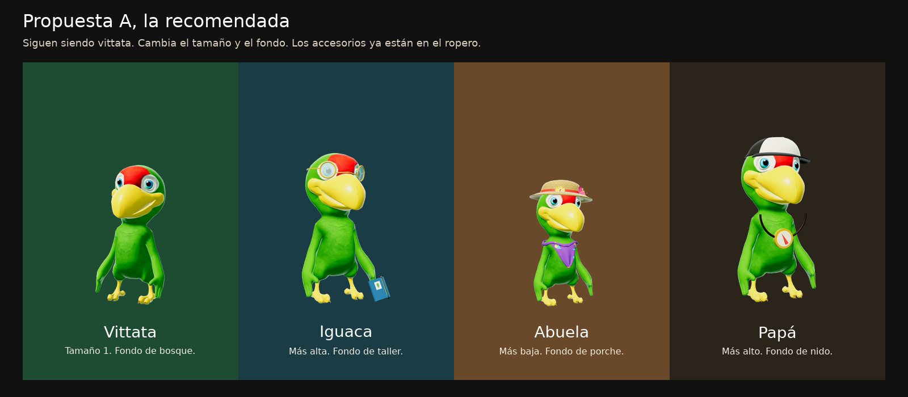
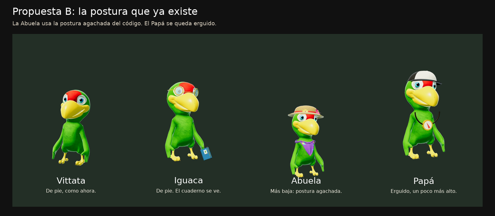
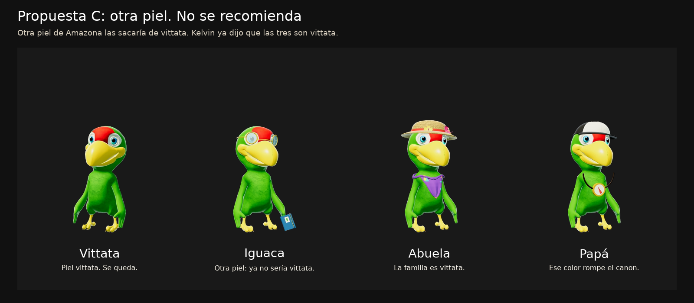
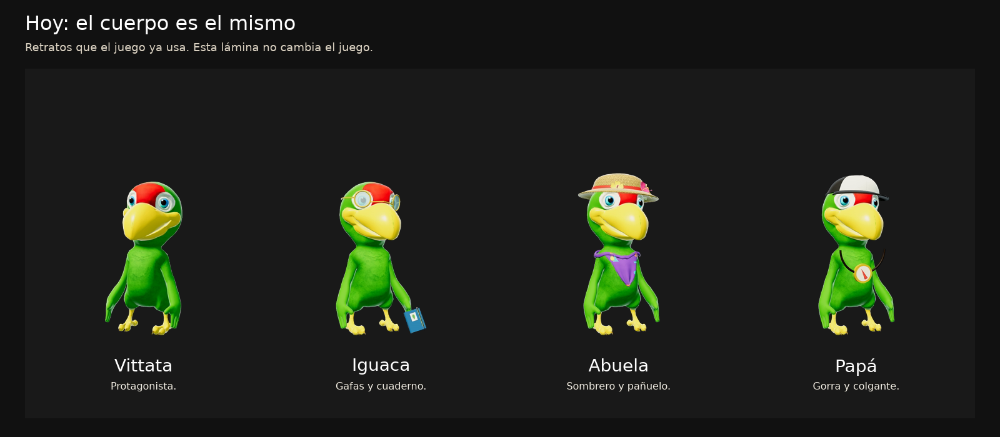

# Iguaca, la Abuela y el Papá (CG-60)

4-nov 2026. Solo propuesta. **No está aplicada al juego.** El modelo y el rig de Vittata no se tocaron.

El 1-nov Kelvin decidió que Iguaca, la Abuela y el Papá son *Amazona vittata*, de la familia de Iguaca. Por eso se parecen: hoy usan el mismo cuerpo verde. Lo que ya los distingue son piezas del ropero que el juego tiene: gafas y cuaderno (Iguaca), sombrero de paja y pañuelo (Abuela), gorra y brújula colgante (Papá).

Marca una letra. Si no contestas, se queda como está hoy.

## A · Recomendada

Mismo plumaje vittata. En el mundo, el grupo se escala (no es otro modelo): Vittata 1, Iguaca 1,08, Abuela 0,86, Papá 1,14. El retrato de diálogo lleva fondo propio: bosque, taller, porche y nido. Los accesorios siguen siendo los que ya están en el ropero (`gafas`, cuaderno de `mano`, `sombrero` o `sombrero2` de paja, `panuelo`, `gorra`, `brujula`).

## B · Postura

La Abuela usa la postura agachada que el personaje ya sabe hacer. Iguaca se queda de pie, un poco más alta, con el cuaderno a la vista. El Papá se queda erguido y un poco más alto. Tampoco hay modelo nuevo.

Se puede sumar a la A. Si solo eliges una, la A se nota más en el retrato.

## C · Otra piel de especie · no se recomienda

El juego ya tiene pieles de otras *Amazona*. Ponerles una haría que dejaran de ser vittata, y eso contradice lo firmado el 1-nov. Esas pieles siguen sirviendo para quien sí es de otra especie (Nayara, Nudo, los visitantes).

## Hoy, para comparar

Las cuatro láminas están en `docs/img/personajes/`. Son montajes de los retratos que el juego ya muestra (`assets/vittata.png`, `assets/luma.png`, `assets/abuela.png`, `assets/papa.png`). No hay un personaje nuevo.
